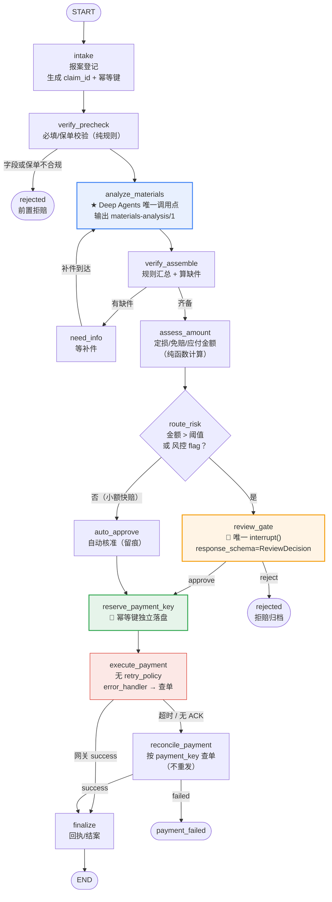

# ARCHITECTURE.md —— 理赔域架构设计（F1）

> 状态：**定稿 v1.0.0（2026-11-18）**，作者 flow-engineer（t9 / F1）
> 契约：`claims/SPEC-claims.md` v1.0.0（字段/状态/错误码以契约为准，本文件只讲**结构与接线**）
> 框架基线：`docs/research/r3-langgraph-deepagents.md`（langgraph **1.2.20** / deepagents **0.7.39**）
> 范围：设计文档。**不包含实现**（实现是 t10 编排 / t11 Deep Agents 层 / t12 集成）。

---

## 1. 设计目标与不变量

| # | 不变量 | 为什么（可测） |
|---|---|---|
| I1 | **业务决策与金额只由服务端确定性代码产生** | CLM-06：模型输出里塞金额不影响 `payable_amount` |
| I2 | **全流程只有一个 `interrupt()`**（`review_gate`） | CLM-08：`grep -c "interrupt("` == 1 |
| I3 | **支付幂等键先落盘、后支付** | CLM-11/13：`reserve_payment_key` 独立节点 |
| I4 | **支付不重发**：超时走查单 | CLM-12：网关只被调用 1 次 |
| I5 | **Deep Agents 只有一个调用点**，且 schema 无金额/结论字段 | §5；CLM-04/15 |
| I6 | **续保域零改动** | `git diff <baseline> -- server tests mcp_servers wiki SPEC.md` 为空 |
| I7 | **轨迹/知识/checkpoint 三处物理隔离** | CLM-16；`traces-claims/`、`data/llm-wiki-claims/`、`claims/data/` |

---

## 2. 图拓扑（LangGraph，节点 id 已避开 Mermaid 保留字 `graph`）



> ⚠️ Mermaid 踩坑备忘：本仓库曾在 `docs/html` 因节点 id 取名 `graph`（Mermaid 保留字）导致整图渲染失败。本图节点 id 全部为 `intake/precheck/analyze/...`，**无 `graph`/`end`/`flowchart` 保留字**。

---

## 3. 节点职责与失败边界

| 节点 | 层 | 读 | 写 | 中断 | retry | error_handler | 失败语义 |
|---|---|---|---|---|---|---|---|
| `intake` | 确定性 | 请求体 | `claim_id/trace_id/status/synthetic` | — | 无 | 无 | `CLAIM_FIELD_INVALID` / `CLAIM_DUPLICATE` / `POLICY_NOT_FOUND` |
| `verify_precheck` | 确定性 | `report/policy_no` | `status`、`precheck` | — | `max_attempts=3`（仅外部核验 API 段） | 无 | 校验失败 → `rejected`（前置拒赔） |
| `analyze_materials` | **Agent** | `doc_ids` + 材料正文 | `materials_analysis` | — | **无**（LLM 昂贵） | 无 | `ANALYSIS_SCHEMA_INVALID`（重试 1 次）/ 降级 → `rules_fallback` |
| `verify_assemble` | 确定性 | `materials_analysis` | `missing_docs/flags/status` | — | 无 | 无 | `MATERIAL_MISSING` |
| `assess_amount` | 确定性 | `materials_analysis/flags/policy_no` | `assessment` | — | 无 | 无 | `AMOUNT_EXCEED_LIMIT` |
| `route_risk` | 确定性（条件边） | `assessment/flags` | — | — | — | — | 分支：`review_gate` / `auto_approve` |
| `review_gate` | 确定性 + HITL | payload | `review_decision/approval_version/reviewer` | **`interrupt()`** | **不挂**（对 interrupt 无效，S1） | 无 | `REVIEW_DECISION_INVALID` |
| `reserve_payment_key` | 确定性 | `assessment/approval_version` | `payment_key` | — | 无 | 无 | 编码守卫：`payment_key` 已存在则跳过（幂等） |
| `execute_payment` | 确定性 + 外部 IO | `payment_key` | `payment_id/paid_at` | — | **不挂** | **有** → `payment_unknown` + 转 `reconcile_payment` | `PAYMENT_REJECTED` / `PAYMENT_AMOUNT_MISMATCH` / `PAYMENT_UNKNOWN` |
| `reconcile_payment` | 确定性 + 外部 IO | `payment_key` | `status` | — | `max_attempts=3`（查单是只读，可重试） | 无 | 保持 `payment_unknown` 等下一轮调度 |
| `finalize` | 确定性 | 全部 | `status=paid`、回执 | — | 无 | 无 | 归档写 `traces-claims/` + 可选 wiki 条目 |

**失败边界原则**（对齐 S3）：节点 = checkpoint 边界 = 重试边界。**昂贵/有副作用的 IO 只放一个节点**，其余保持纯函数，便于重跑。

---

## 4. 状态与持久化

| 项 | 设计 | 依据 |
|---|---|---|
| State schema | `claims/state.py::ClaimState(TypedDict, total=False)`，字段见 SPEC §4.1 | S4（state 显式） |
| checkpointer | `SqliteSaver(sqlite3.connect("claims/data/checkpoints.sqlite"))` | S2（本地文件型，非 `MemorySaver`） |
| `thread_id` | **= `claim_id`**（重审不换线程，用 `approval_version` 区分） | S1（resume 必须同 thread_id） |
| durability | 入口 `invoke(..., durability="sync")`（只传合法三档；非法值本机会被静默接受，需自查） | S2 + S8 |
| `recursion_limit` | **显式** `config["recursion_limit"] = 40`（顶层键，不是 `configurable` 下） | S4 + S8 |
| 崩溃恢复 | 进程重启后 `get_state(config)` → `next=('review_gate',)` → `Command(resume=ReviewDecision(...))` 续跑；**已完成节点不重跑** | S8（两进程实测） |

> 注：`review_gate` 被中断后若**再次** resume，`interrupt()` 之前的代码会重跑（S1）。因此 `review_gate` 节点内 `interrupt()` **之前只做纯读**，任何写库/发通知都放到 resume 之后的节点。

---

## 5. Deep Agents 层：唯一调用点与边界

### 5.1 调用形态

- **位置**：`analyze_materials` 节点**内部**调用 `claims/deep_agents/analyst.py::run_analysis(...)`；该函数返回 `create_deep_agent(...)` 构建的 `CompiledStateGraph` 的一次 `invoke` 结果（S6：返回类型即 `CompiledStateGraph`，说明它本身就是 LangGraph 图）。
- **不是**把 Deep Agents 当主控图：外层状态机仍由本域 `claims/graph.py` 掌控（S5「workflow vs agent」口径）。
- **子代理**：材料量大时用 `subagents=[{name:"photo-inspector", ...}]`，由主 agent 经 `task` 工具调用（**不是** LangGraph 节点，S5）；单材料场景不启用子代理以省 token。
- **后端**：`FilesystemBackend(root_dir=claims/data/materials/<claim_id>)`（只读写，不给 `execute`，避免 shell）。
- **planning**：`deepagents>=0.7` 的 todo 是 opt-in；仅当材料 > 3 份时传 `TodoListMiddleware`。
- **输出**：`response_format=MaterialsAnalysis`（Pydantic）→ 结构化 JSON（SPEC §4.3），**无金额/结论字段**。

### 5.2 边界（谁能决定什么）

```
材料原文 ──► Deep Agents ──► facts + evidence(span, quote) + confidence + missing_items
                                    │
                                    ▼  （只作为"证据"进入）
                        assess_amount（纯函数：费率表/免赔额/上限） ──► payable_amount
                                    │
                                    ▼
                        review_gate（人）──► approve/reject
```

- Deep Agents **不能**：算金额、给责任比例、给通过/拒绝建议、写最终状态。
- Deep Agents **能**：抽取事实、标注出处、指出缺件、指出不一致（`consistency_notes`/`anomalies`）。
- 引用必须是材料**逐字子串**（沿用 LLM-Wiki 断言级引用口径），校验函数 `claims/tools/verify_quote.py`；不合格的 `fact` 直接丢弃并计 `LOW_CONFIDENCE` flag。

### 5.3 降级（`DEEPAGENTS_ENABLED=false`）

- `claims/tools/rules_analyzer.py` 用正则/模板抽取同 schema 的结果，`analyzer.mode="rules_fallback"`，`cost` 全 0。
- 触发 `llm_degraded` 事件（`error_type="DeepAgentsUnavailable"`），轨迹留痕。
- **目的**：t12 集成时环境没装 `deepagents` 也能端到端跑通（CLM-15）。

---

## 6. 中断设计（`review_gate`）

```python
def review_gate(state: ClaimState) -> Command[Literal["reserve_payment_key", "rejected"]]:
    # ① interrupt 必须在最前面；不要 try/except 包住（S1）
    decision = interrupt(
        {"kind": "claim_review", "claim_id": state["claim_id"],
         "payable_amount": state["assessment"]["payable_amount"],
         "line_items": state["assessment"]["line_items"],
         "flags": state.get("flags", []), "missing_docs": state.get("missing_docs", []),
         "allowed_decisions": ["approve", "reject"], "synthetic": True},
        response_schema=ReviewDecision,          # langgraph>=1.2.12（本机 1.2.20，S1）
    )
    # ② 之后只做纯状态写入；副作用放后续节点
    if decision.decision == "approve":
        return Command(update={...}, goto="reserve_payment_key")
    return Command(update={...}, goto="rejected")
```

| 设计点 | 选择 | 理由 |
|---|---|---|
| 中断位置 | `review_gate`（金额计算之后、支付之前） | 人在**不可逆动作前**做决定（S10） |
| 决策集 | `approve` / `reject` | 不给 `edit`：编辑金额参数会让模型重算并重复执行（S5 Tip） |
| resume 载荷 | `Command(resume=ReviewDecision)` | `resume` 是 `invoke` 唯一合法 Command 形态（S1） |
| 多态（补件） | **不新增 interrupt**：`request_more` 用 `review_assemble` 规则判断 → 走 `need_info` 边 | resume 值按**索引**匹配，多 interrupt 易错（S1） |
| 挂起事件 | 复用 `await_confirm` | 不新增 SSE event 名（SPEC §6.1） |

---

## 7. 幂等与支付

| 环节 | 设计 | 依据 |
|---|---|---|
| 键内容 | `sha256(claim_id\|policy_no\|payable_amount\|approval_version)` | 可由持久化 state 复现（S3） |
| 生成位置 | **`reserve_payment_key` 独立节点**，先被 checkpoint | S3 明确："persist a generated key in its own node before the side effect" |
| 读取位置 | `execute_payment` 只读 `state["payment_key"]`，**不生成** | 崩溃重试时键必须一致（S3 反例：K1/K2 双扣） |
| durability | `sync`（崩溃后 key 才可靠） | S2 |
| 支付重试 | **无 `retry_policy`**；`error_handler` 捕获 → `Command(goto="reconcile_payment")` + `status="payment_unknown"` | S3：「缺失 ACK 视为未知而非未发生」 |
| 查单 | `reconcile_payment` 以 `payment_key` 查网关 | 幂等键是对账锚点 |
| 网关去重 | 模拟网关以 `payment_key` 为幂等键（重复请求返回首次结果） | 模拟实现要求 |

---

## 8. 与既有基础设施的接线（复用清单，逐函数）

> 原则：**只 import，不改一行**。切换目录靠 `server/config.py` 已支持的环境变量（`TRACE_DIR` / `WIKI_DIR`，见 `server/config.py` 的 `TRACE_DIR`/`WIKI_DIR` 定义），因此**无需 fork/copy**。

### 8.1 轨迹：`server/trace.py`

| 复用项 | 用法 | 为什么用它 |
|---|---|---|
| `TraceRecorder(trace_id, session_id, trace_dir=None)` | `TraceRecorder(trace_id=claim_id, session_id=sid)`；进程环境 `TRACE_DIR=traces-claims` | 自动 `mkdir` + 文件 `0600`（PII 载体） |
| `TraceRecorder.record(record_type, *, node, event, input, output, latency_ms, tokens_in, tokens_out, error, mode, degraded, error_type)` | 每节点 `node_start`/`node_end`；工具 `tool_call`/`tool_result`；降级 `llm_degraded` | **11 种 record_type 白名单**强校验（非法值 raise），理赔语义全部塞 `event` |
| `read_trace(trace_id, trace_dir=None)` | `GET /claims/{claim_id}/trace` 读回 | 与续保同构，前端可复用渲染 |
| 禁止 | 新增 record_type / 直接写 `traces/` | 会 `ValueError` 或污染续保 |

### 8.2 安全：`server/security.py`

| 复用项 | 用在哪 |
|---|---|
| `redact_row(row)` / `redact_obj(obj)` / `redact_text(s)` | 轨迹写入前脱敏；材料摘要给 LLM 前脱敏（`RENEWAL_TRACE_PII=redact` 默认） |
| `sanitize_input(text)` + `max_message_chars()` | 报案「事故经过」长度与字符清洗 |
| `scan_untrusted(text)` → `{score, level, signals, chars}` | 每份材料入分析前扫注入；`level != none` → 记 flag + `wrap_untrusted` |
| `wrap_untrusted(text)` / `neutralize_delimiters(text)` | 材料正文送进 prompt 时包裹，防「材料里的指令」被执行 |
| `authorize_tool_args(tool, arguments, session_owner)` + `SecurityViolation` | 每次 `payment_charge`/`payment_query`/`get_policy` 前断言：`owner_id` 必须等于会话车主 |
| `guard_system_prompt(system)` | 深代理 system_prompt 加固（防材料越权指令） |
| `pii_mode()` | 诊断：确认当前不是 `keep`（生产/演示默认 redact） |

### 8.3 指标：`server/metrics.py`

| 复用项 | 用在哪 |
|---|---|
| `observe_record(row)` | 每条轨迹行喂指标（与续保同一口径，`/metrics` 自动含理赔域） |
| `finish_turn(trace_id, duration_s, outcome)` | 每个 claim 处理结束（`outcome ∈ {paid,rejected,need_info,payment_unknown,error}`） |
| `turn_counts(trace_id)` | 单 claim token/工具调用统计（成本核算） |
| `render()` / `reset()` | 测试与 `/metrics` |

### 8.4 记忆：`server/memory.py`（**可选**，只用于「报案人历史」）

| 复用项 | 用法 |
|---|---|
| `put(owner_id, field, value, *, kind, source, confidence, ttl_days, reason)` | 记 `claims_report_history`（如「近 12 个月第 2 次同部位报案」） |
| `get(owner_id, field)` / `active_items(owner_id, kind=...)` | `verify_assemble` 读回做 `DUPLICATE_PATTERN` 判定 |
| `search(owner_id, query=...)` / `render_brief(owner_id, limit=8)` | 生成「历史摘要」注入 prompt（限 token） |
| 隔离 | `owner_id` 统一加前缀 `claims:`（如 `claims:OWN-1001`），避免与续保 owner 空间混淆；`forget/export_owner` 仅作用于该前缀 |

> 若 t10 认为不需要历史记忆，可整块不接（本域对 `memory.py` 无硬依赖）。

### 8.5 知识检索：`server/wiki_search.py`

| 复用项 | 用法 |
|---|---|
| `WikiSearch(wiki_dir=None, channels=DEFAULT_CHANNELS)` + `search(...)` | `WIKI_DIR=data/llm-wiki-claims/wiki` 注入；只读检索理赔条款，供 `analyze_materials` 做条款比对 |
| `hits_for_trace(entries, scores)` | 轨迹 `retrieval` 行（与续保同格式） |
| 隔离 | 只读；**不得写** wiki 目录（写是数据流水线 D3 的职责） |

### 8.6 配置：`server/config.py`

| 环境变量 | 理赔域取值 | 作用 |
|---|---|---|
| `TRACE_DIR` | `traces-claims` | 轨迹目录隔离（已支持，零改动） |
| `WIKI_DIR` | `data/llm-wiki-claims/wiki` | 知识目录隔离（已支持） |
| `DEEPAGENTS_ENABLED` | `false`（默认）/`true` | 材料分析走深代理还是规则降级 |
| `DEEPAGENTS_PYTHON` | `.venv-claims/bin/python` | t15 装好后指向独立解释器（可配置，不硬编码） |
| `CLAIMS_CHECKPOINT_DB` | `claims/data/checkpoints.sqlite` | checkpointer 路径 |
| `CLAIMS_AMOUNT_REVIEW_THRESHOLD` | `3000`（合成演示值） | `route_risk` 的金额阈值 |

---

## 9. 目录结构（本域新增，全部为新建，不改既有）

```
claims/
├── SPEC-claims.md          # 契约（v1.0.0）
├── ARCHITECTURE.md         # 本文件
├── README.md               # 域说明（C0 已建，F1 复用）
├── state.py                # ClaimState TypedDict（t10）
├── graph.py                # build_claim_graph()：状态图装配（t10）
├── nodes/                  # 各节点实现（t10）
├── deep_agents/            # analyst.py + schema.py + prompts（t11）
├── tools/                  # payment_gateway.py / verify_quote.py / rules_analyzer.py（t11）
├── data/                   # checkpoints.sqlite / materials/ / cache/（运行态，gitignore）
└── tests/                  # CLM-01~20、SEC-CLM-01~04（t10/t11）
```

---

## 10. 被否决的备选方案

| 方案 | 否决理由 |
|---|---|
| A. 让 Deep Agents 当主控（整个理赔流程交给 agent，用 `task` 拉子代理跑各阶段） | ① 官方 workflow/agent 口径支持确定性流程用 workflow（S4/S5）；② agent 无天然步数上限 → 支付副作用不可预测；③ 与 I2/I3/I4 冲突 |
| B. 在 `execute_payment` 里生成幂等键 | 官方明示反例（K1/K2 双扣，S3）；崩溃重试必重复扣款 |
| C. 支付节点挂 `retry_policy=max_attempts=3` | 超时重试会对不可逆操作重复调用；应查单（S3） |
| D. 审核后用第二次 `interrupt()` 确认支付 | resume 从节点头重跑 → 已成功扣款会被重复执行；且多 interrupt 索引匹配易错（S1） |
| E. `MemorySaver` 当 checkpointer | 重启即丢，跨进程恢复（CLM-10）不可能（S2） |
| F. fork `server/trace.py` 加理赔 record_type | 违反"不改续保"；`record()` 白名单校验会失败；用 `event` 字典足够 |
| G. 把 `materials_analysis` 的 `facts` 直接映射成 `payable_amount` | 违反 I1；金额必须走 `assess_amount` 纯函数 |
| H. 让模型输出自然语言结论供审核员参考 | 无结构化出处 → 不可测、不可审计；改为 `facts + evidence.quote`（逐字子串） |
| I. 每次分析都新开 `thread_id` 并保留全轨迹 | checkpoint 膨胀（S2 坑）；用 `analysis_key` 缓存即可 |

---

## 11. 风险与遗留

| # | 风险 | 缓解 |
|---|---|---|
| R1 | `deepagents` 未装（t15 进行中） | 默认 `DEEPAGENTS_ENABLED=false` + `rules_fallback` 同 schema（CLM-15） |
| R2 | `tenacity 9.2.1→9.1.4` 降级影响续保测试 | 装在 `.venv-claims`，共享 `.venv` 不动（t15 双跑验证） |
| R3 | LLM 抽取质量波动导致 `LOW_CONFIDENCE` 泛洪 | 置信度阈值 + 「低置信度转人工」而非「猜」；`ANALYSIS_SCHEMA_INVALID` 只重试 1 次 |
| R4 | 模拟支付网关与真实网关语义差异 | 网关接口固定三方法（charge/query/refund 预留），以 `payment_key` 为幂等键；真实接入只替换实现 |
| R5 | `review_gate` 长期挂起占资源 | checkpoint 持久化，进程可退出；恢复靠 `Command(resume=...)`（S1/S8） |
| R6 | 轨迹体量大 | 复用 `TraceRecorder` 的 11 类记录 + `event` 精简；分析原文进 `claims/data/cache/` 不进轨迹 |

---

## 12. 变更记录

| 版本 | 时间 | 变更 | 作者 |
|---|---|---|---|
| v1.0.0 | 2026-11-18 | 首版：拓扑、节点边界、Deep Agents 唯一调用点与降级、interrupt 设计、幂等/支付、持久化、复用接线（trace/metrics/security/memory/wiki_search/config）、被否决方案 9 条 | flow-engineer (t9/F1) |
