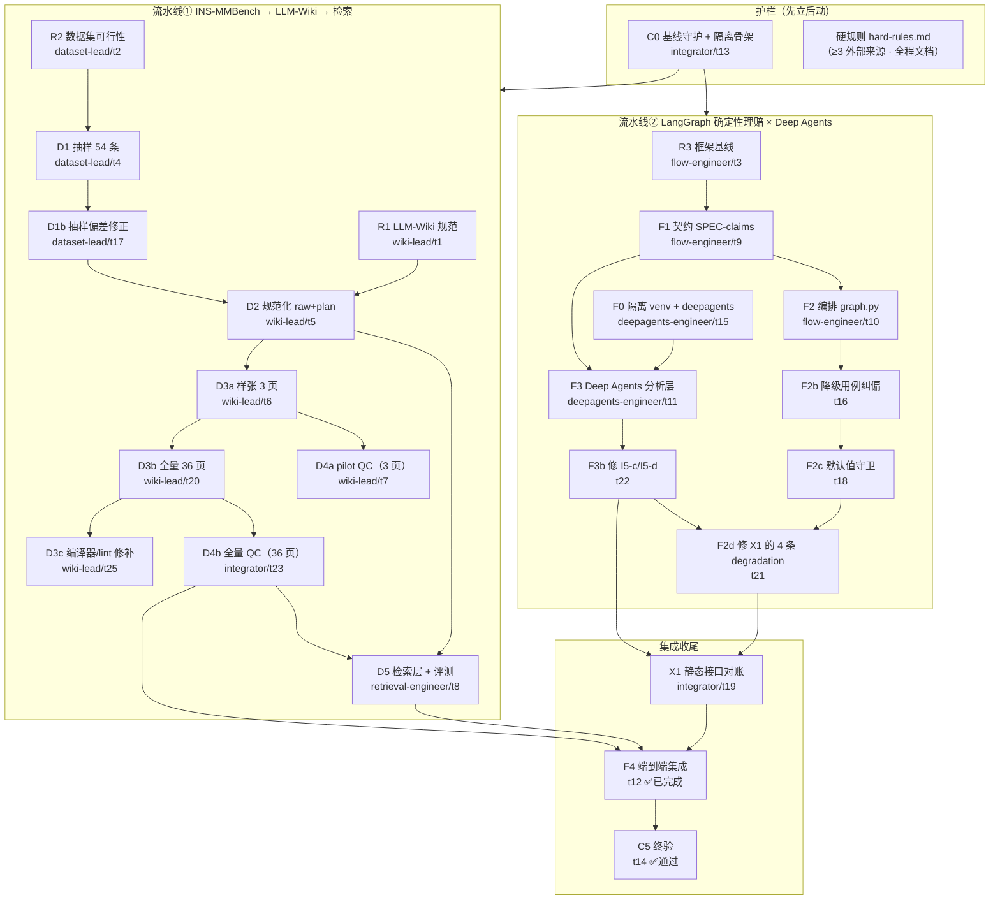

# INDEX · 理赔域 + INS-MMBench 全流程总账

> **这是什么**：`docs/log/` 下 20+ 份 `step-*.md` 的**总索引**。回答四个问题：这套东西做了什么／证据在哪／哪些还没做／哪里自相矛盾。
> **性质**：**只读汇总**。本文件不修改任何 `step-*.md`、不改代码、不改 `decisions.md`（t24 契约）。
> **数据采集时间**：2026-11-18 19:18–19:51（+0800）。所有数字都是本次**我自己跑出来**的，不抄任何人的报告；凡引用他人日志的结论，均标注了文件名。
> **时效警告**：编写期间 `t8`（D5）与 `t25`（D3c）仍在写文件，测试数字会漂移——每条数字都带时间戳（见 §4）。

---

## 1. 全景



**依赖要点（有据可查）**：D-10 曾把 F1 的依赖从 `(R3, D4)` 改为 `(R3, R1)`、F3 从 `(F1, D4)` 改为 `(F1, F0)`，理由见 `decisions.md` D-10；X1 的 2 blocker + 9 degradation 又在 t21/t22 被反哺修回（见 `docs/log/integration-contract.md`）。

---

## 2. 步骤索引表

状态图例：✅ 已完成且有证据 ｜ ⚠️ 完成但**证据/文档有缺口** ｜ ⏳ 未开始

| 步骤 | 任务 id | 负责 | 产物（真实路径） | 状态 | 关联决策 |
|---|---|---|---|---|---|
| **R1** LLM-Wiki 规范 | `t1` | wiki-lead | `docs/research/llmwiki-spec.md`；日志 `docs/log/step-r1.md` | ✅ | D-03、D-23（引用口径） |
| **R2** 数据集可行性 | `t2` | dataset-lead | `docs/research/ins-mmbench-access.md`；日志 `docs/log/step-r2.md` | ✅ | D-03、D-12 |
| **R3** 框架基线 | `t3` | flow-engineer | `docs/research/r3-langgraph-deepagents.md`；日志 `docs/log/step-r3.md` | ✅ | D-05、D-11、E-01 |
| **C0** 基线守护 / 隔离骨架 | `t13` | integrator | `docs/log/step-c0-baseline.md`、`docs/log/hard-rules.md`、`docs/log/step-c0-gate.md`；目录 `claims/`、`data/`、`traces-claims/`；`.gitignore` | ✅ | D-01、D-02 |
| **D1** 子集抽样 | `t4` | dataset-lead | `data/ins-mmbench/scripts/fetch_subset.py`、`data/ins-mmbench/manifest.json`、`data/ins-mmbench/records.jsonl`、`data/ins-mmbench/raw/**`、`data/ins-mmbench/.fetch-progress.json`、`data/ins-mmbench/FETCH.md`；日志 `docs/log/step-d1.md` | ✅ | D-03、D-04、D-12 |
| **D1b** 抽样偏差评估与描述修正 | `t17` | dataset-lead | `data/ins-mmbench/manifest.json` 内 `splits.liability.strategy=head_window_complete_records` + `sampling_note`（跳过 9 条清单）；日志 `docs/log/step-d1.md` §1.1 / §4.9 | ✅ | D-14 |
| **D2** raw 规范化 + plan | `t5` | wiki-lead | `data/llm-wiki-claims/raw/sources/raw-*.json`（54）、`data/llm-wiki-claims/raw/manifest.json`、`data/llm-wiki-claims/plan.md`、`data/llm-wiki-claims/scripts/normalize_raw.py`；日志 `docs/log/step-d2-normalize.md`（`step-d2.md` 为指针） | ✅ | D-04 |
| **D3a** 样张编译 3 页 | `t6` | wiki-lead | `data/llm-wiki-claims/wiki/{index.md,log.md,schema.md}`、`data/llm-wiki-claims/wiki/docs/ins-mmbench-agricultural.md`、`data/llm-wiki-claims/wiki/sections/agri-insured-subject.md`、`data/llm-wiki-claims/wiki/faqs/agri.md`、`data/llm-wiki-claims/scripts/compile_wiki.py`、`data/llm-wiki-claims/scripts/wiki_lint.py`；日志 `docs/log/step-d3-compile.md` | ✅ | — |
| **D3b** 全量 36 页 | `t20` | wiki-lead | `data/llm-wiki-claims/wiki/{docs,sections,entities,faqs}/*.md`（4+18+9+5=36）；日志 `docs/log/step-d3b.md` | ✅ | D-23 |
| **D3c** 编译器/lint 收尾修补 | `t25` | wiki-lead | `data/llm-wiki-claims/scripts/compile_wiki.py`（`--pages` 空串根因）、`data/llm-wiki-claims/scripts/wiki_lint.py`（L12 log↔页面 1:1）；日志 `docs/log/step-d3c.md` | ✅（曾为骨架，19:18 已补齐） | D-23 |
| **D4a** pilot QC（3 页） | `t7` | wiki-lead | `data/llm-wiki-claims/scripts/wiki_claims_lint.py`（第二套检查器）+ 修复 7 类；日志 `docs/log/step-d4-lint.md` | ⚠️ 仅 3 页口径，不可外推到 36 页 | — |
| **D4b** 全量 QC（36 页） | `t23` | integrator | `data/llm-wiki-claims/wiki/**`（修生成器后重建）、`data/llm-wiki-claims/scripts/compile_wiki.py`、`data/llm-wiki-claims/scripts/wiki_lint.py`（L6 加固）；日志 `docs/log/step-d4.md` | ✅ | — |
| **F0** 隔离 venv + deepagents 0.7.39 | `t15` | deepagents-engineer | `.venv-claims/`（解释器）、`claims/requirements-claims.txt`、`docs/research/f0-deepagents-0739-install-evidence.md`、`claims/deep_agents/probe_f0.py`；日志 `docs/log/step-f0.md` | ✅ | D-05、E-01、E-02 |
| **F1** 理赔域契约与架构 | `t9` | flow-engineer | `claims/SPEC-claims.md`（v1.0.x）、`claims/ARCHITECTURE.md`；日志 `docs/log/step-f1.md`（`step-f1-arch.md` 为指针） | ✅ | D-07、D-08、D-11、E-03 |
| **F2** LangGraph 四段编排 | `t10` | flow-engineer | `claims/graph.py`、`claims/state.py`、`claims/config.py`、`claims/tools/{logic,rules_analyzer,payment_gateway,verify_quote,synthetic}.py`、`claims/tests/{test_flow,test_logic}.py`；日志 `docs/log/step-f2.md`（`step-f2-flow.md` 为指针） | ✅ | D-06、D-07、D-08 |
| **F2b** 降级用例纠偏 | `t16` | flow-engineer | `claims/tests/test_flow.py`（"因错误原因通过"的用例改写）；日志 `docs/log/step-f2b.md` | ✅ | — |
| **F2c** `DEEPAGENTS_ENABLED` 默认值守卫 | `t18` | flow-engineer | `claims/tests/test_config_defaults.py`、`claims/tests/conftest.py`（会话级护栏；**P2 修正：原写作 `claims/conftest.py`，该文件不存在**）；日志 `docs/log/step-f2c.md` | ✅ | — |
| **F2d** 修 X1 的 4 条 degradation + 运行前提 | `t21` | flow-engineer | `claims/graph.py`（`_terminal_snapshot`/`_analysis_key`/`_LAST_ANALYSIS_ERROR`/`node_end` 包装）、`claims/tools/logic.py`（`ANALYSIS_ANOMALY_CODES`）、`claims/tests/test_f2d_degradations.py`；日志 `docs/log/step-f2d.md` | ✅ | D-15、D-16、D-17、D-18、D-19、D-20、D-21、D-22 |
| **F3** Deep Agents 材料分析层 | `t11` | deepagents-engineer | `claims/deep_agents/{analyzer,schema,materials,prompts,errors,analyst,schemas,probe_f0}.py`、`claims/deep_agents/tests/*.py`；日志 `docs/log/step-f3.md` + `docs/log/step-f3-deepagents.md` | ✅ | D-11、E-03 |
| **F3b** 修 I5-c / I5-d | `t22` | deepagents-engineer | `claims/deep_agents/materials.py`（`CLAIMS_DATA_DIR` 接线）、`claims/deep_agents/analyzer.py`（env 登记）、`claims/deep_agents/tests/test_workspace_isolation.py`；日志 `docs/log/step-f3b.md` | ✅ | — |
| **X1** 静态接口对账（6 条契约） | `t19` | integrator | `docs/log/integration-contract.md` | ✅ | 反哺 D-15…D-22 |
| **D5** 理赔检索层 + 检索评测 | `t8` | retrieval-engineer | `claims/wiki_retrieve.py`、`claims/eval_retrieval.py`、`claims/tests/test_d5_wiki_retrieval.py`；日志 `docs/log/step-d5.md`（**19:51 补齐**，四节完整）；研究依据 `docs/log/prep-d5-retrieval.md`；指针 `docs/log/step-d5-retrieval.md` | ✅（评测数字见 §4.4） | D-21、D-24 |
| **F4** 端到端集成（HTTP/SSE + E1–E6） | `t12` | integrator | `claims/api.py`（FastAPI + SSE 七端点）、`claims/demo_claim.py`（E1–E6 CLI 门禁）、`claims/tests/test_f4_api.py`（8 例）；日志 `docs/log/step-f4.md` | ✅ PASS 8/8（2026-11-18 23:0x；**连跑两次均 PASS**，2026-11-19 01:5x）；轨迹为追加式：`traces-claims/<claim_id>.jsonl` 行数随运行次数增长（+20/次），判据是结构不是行数（见 step-f4 §5.2） | — |
| **C5** 方案 C 终验 | `t14` | integrator | `docs/log/step-c5.md`（A 零回归 / B 隔离性 / C wiki 一致性 16 条自审 / D 硬规则审计） | ✅ **通过**（2026-11-19 01:52；遗留 M-01 决策编号回引 / L-01 指针文件） | — |

> 指针文件（内容 0，仅指路）：`docs/log/step-d2.md` → `step-d2-normalize.md`；`step-f1-arch.md` → `step-f1.md`；`step-f2-flow.md` → `step-f2.md`。读总账时不要把它们当成"独立步骤"。

---

## 3. 决策台账索引

来源：`docs/log/decisions.md`（只追加）。**实际条数（20:48 复核）**：`D-01…D-12` + `D-14…D-26`（**共 25 条，缺编号 D-13**）+ `E-01…E-03`（勘误 3 条）+ `O-01…O-03`（待决 3 条，不计入决策数）。
> 注：D-24/D-25/D-26 是 **19:35 新增**的（本总账初稿编写中，见 §6.4-7），已收录。

### 3.1 速查表

| 编号 | 一句话 | 影响范围 |
|---|---|---|
| D-01 | 交付根 = `renewal-assistant/`（方案 C），废弃 `homework5/insurance-agent/` | 全队路径口径；C0 骨架 |
| D-02 | 隔离靠环境变量（`TRACE_DIR` / `WIKI_DIR`），不改续保代码 | F1/F2/F3 接线；C5 隔离验收 |
| D-03 | 子集固定 54 题（property 6 + 其余各 12），禁止按吞吐动态定 k | D1 脚本；manifest |
| D-04 | 排除 `fundamental.tsv`；D5 **只报检索指标**，不报问答准确率（`answer` 全 null） | D5 评测口径；对外结论表述 |
| D-05 | deepagents 装独立 `.venv-claims`，共享 `.venv` 不动 | F0；F3 运行环境 |
| D-06 | `claims/tests` 不并入默认 `testpaths`（保 148 基线可比） | C5 口径；CI |
| D-07 | `CLAIMS_AMOUNT_REVIEW_THRESHOLD=3000` 是演示配置值，须标"生产按条款配置" | F1/F2 配置 |
| D-08 | 轨迹只用既有 11 种 `record_type`，理赔语义塞 `event` 且必须 `claims.` 前缀 | F2 轨迹；C5 审计 |
| D-09 | 研究证据：文本源入库，`*.html` 快照不入库（靠 MANIFEST 的 sha256 复现） | `.gitignore`；全部取证方式 |
| D-10 | DAG 去串行化（F1 不等 D4；F3 依赖 F0） | 调度并行度 |
| D-11 | Deep Agents 只做材料抽取，schema 顶层无金额/责任/结论 | F1 schema、F3 实现 |
| D-12 | 「只抽样不拉全量」的唯一路径：镜像 + HTTP Range + 顺序追加 + 可续传 | D1 脚本；manifest |
| **D-13** | **（缺号，台账未出现此编号——见 §6.4）** | — |
| D-14 | liability 非严格 head-k：不重取，改 `head_window_complete_records` + 记录跳过清单 | manifest；D5 结论边界 |
| D-15 | 轨迹首行必须归属 `claim_id`（修 `unknown.jsonl`） | `claims/graph.py`；CLM-20 |
| D-16 | 降级必须可归因（`error_type`/`error_class` 进轨迹，不改契约签名） | `claims/graph.py`；SPEC §9 |
| D-17 | 终态即终点：已终态/无挂起中断 → 不 invoke、不 charge | `claims/graph.py` invoke/resume |
| D-18 | 指标接线走 `_wrap()` 的 `node_end`/`tool_call`/`tool_result`（不手调 observe_record） | `claims/graph.py`；/metrics |
| D-19 | `analysis_key` 缓存落地（命中置 `analysis_cached`） | `claims/graph.py`；SPEC §3.2 |
| D-20 | `anomalies` 不进 `flags`（技术信号 ≠ 业务信号） | `claims/tools/logic.py`；SPEC §4.6 |
| D-21 | `CLAIMS_WIKI_DIR` 为理赔域唯一知识目录，禁读续保 `wiki/` | SPEC §8.1；D5 接线 |
| D-22 | 运行前提：理赔流水线含 F3 必须用 `.venv-claims/bin/python`（否则"假绿"） | SPEC §8.0；CI/验收命令 —— **（现状：`.venv` 下 `claims/deep_agents/tests` 为 24 failed / 58 passed，2026-11-19 01:56 实测；根因未变，只是随用例增加由 20 failed 涨到 24；见 `step-c5-final.md`）** |
| D-23 | 接受 D3b 的 `log.md` 收敛（对"只追加"的一次已声明偏离）+ 把 log↔页面 1:1 写进 lint | `wiki/log.md`；`wiki_lint.py` L12 |
| D-24 | `labels.claim` 同名不同义：**不重映射**，接受缓解 + 登记为限制（理由：重映射要改 `plan.md` 实体模型→重生成→又一次并发写窗口） | `entities/compensation-tier`（分片分列）；`step-d4.md` |
| D-25 | **wiki 单写者规则**：`data/llm-wiki-claims/{scripts,wiki}/**` 从 t25 起仅 wiki-lead 可写；C5 必须在 t25 后复跑两套 lint + 引用审计 | `t14` 依赖；`step-d4.md §7` |
| D-26 | index 允许 `type` 移到分组标题，**但不接受摘要截断**：改由页面元数据确定性生成短标签（≤30 字、无省略号） | `index.md` 生成逻辑；`schema.md`；t26 |
| E-01 | 「FilesystemBackend 不执行 shell」应读作「不向模型暴露 shell」（文档精度问题） | R3 §4 表述 |
| E-02 | tenacity 降级真因 = `google-genai` 要求 `tenacity<9.2.0` | D-05 结论强化 |
| E-03 | schema 约束有官方入口 `response_format`，F3 必须用、不得只靠 prompt | F3 实现 |

### 3.2 引用核查：哪些决策真的被某步日志引用？

方法：`grep -rl "<编号>" docs/log/step-*.md docs/log/prep-d5-retrieval.md`（**按编号字面**匹配）。

**被日志按编号引用的（5 条）**：

| 决策 | 引用它的日志 |
|---|---|
| D-03 | `step-d1.md` |
| D-04 | `step-d1.md`、`step-d2-normalize.md` |
| D-14 | `step-d1.md` |
| D-15 | `step-f2d.md` |
| D-22 | `step-f2d.md` |

**孤立决策（20 条：编号未被任何 step 日志引用）**——但**不等于没落地**。按"是否有代码/产物证据"二分：

| 决策 | 代码/产物证据（本次实查） | 判定 |
|---|---|---|
| D-01 | 目录 `claims/ data/ traces-claims/` 存在；`insurance-agent/` 已不存在 | 落地，仅"编号未回引" |
| D-02 | `claims/config.py:51-64` 读 `CLAIMS_TRACE_DIR`/`CLAIMS_WIKI_DIR`；C0 文档 §5 有实测 | 落地，编号未回引 |
| D-05 | `.venv-claims/bin/python` 存在；`claims/requirements-claims.txt` 含 `deepagents==0.7.39` | 落地，编号未回引（`step-f0.md` 谈的是"独立 env"，未写编号） |
| D-06 | `pyproject.toml` 的 `testpaths` 仍为 `["tests","mcp_servers"]`，`claims/tests` 未被收 | 落地 |
| D-07 | `claims/config.py` docstring + `SPEC-claims.md` §8.1 均标"演示值/生产需配置" | 落地 |
| D-08 | `claims/state.py::Event`（19 个 `claims.*` 值）+ `graph.py::record()` 强校验前缀 | 落地 |
| D-09 | `.gitignore` 有 `docs/research/evidence/**/*.html` 规则 + `MANIFEST.md` 在库 | 落地 |
| D-10 | 无运行时可验；仅在 `decisions.md` 与调度路径中体现 | **仅台账**（无法从产物反查） |
| D-11 | `claims/deep_agents/schema.py` 顶层字段无 amount/payout/decision；`FORBIDDEN_FIELD_NAMES` 断言 | 落地 |
| D-12 | `data/ins-mmbench/scripts/fetch_subset.py` + manifest 的 `endpoint/http_ranges` | 落地 |
| D-16 | `claims/graph.py:47` `_LAST_ANALYSIS_ERROR`（ContextVar） | 落地 |
| D-17 | `claims/graph.py:598` `_terminal_snapshot()` | 落地 |
| D-18 | `claims/graph.py:195-202` `_wrap()` 补 `node_end`（注释直接引用 X1 判定） | 落地 |
| D-19 | `claims/graph.py:105/116` `_load_analysis_cache`/`_store_analysis_cache` | 落地 |
| D-20 | `claims/tools/logic.py:36` `ANALYSIS_ANOMALY_CODES` | 落地 |
| D-21 | `claims/SPEC-claims.md:389` 已登记 `CLAIMS_WIKI_DIR`；`claims/config.py:63` | 落地 |
| E-03 | `claims/deep_agents/analyzer.py` 使用 `response_format`（2 处） | 落地 |
| D-24 | `entities/compensation-tier.md` 分片分列 + 【方法约束】告警；`step-d4.md §2.3` 有实测 | 落地（缓解），编号未回引 |
| D-25 | 规则类，无运行时产物；`step-d4.md §7` 已列复跑命令 | **仅台账**（待 C5 采纳） |
| D-26 | `index.md` 短标签已生效：无省略号、体积 5867 B（<6144）、编译器 `LABEL_MAX = 30` | 落地 |

**真正"只有台账、没有其它痕迹"的：D-10（DAG 调整）**——属调度层决策，产物无法体现，只能以 `decisions.md` 为准。
**D-23 与 E-01/E-02** 虽未被 `step-*.md` 按编号引用，但有产物证据：D-23 → `wiki_lint.py:428-431` 的 L12 检查；E-01/E-02 → `docs/research/f0-deepagents-0739-install-evidence.md`。

> 结论：**决策落地率高，但"编号回引"率低（5/25 = 20%）**。这不是内容缺失，而是**台账与日志之间缺少双向链接**——C5 若要逐条核对，只能像本表这样反查产物。**建议 C5 在终验时按本表补做一次"决策→产物"核对**。

---

## 4. 测试矩阵（本次实跑，带时间戳）

### 4.1 测试矩阵（C5 终验口径；**每个数字都绑定 命令 + 解释器 + 时间戳**）

> **为什么这样写**（C5b 的核心批评）：测试数字当交付凭据时，只写“78 passed”就是**假事实**——下一次代码改动（比如 F4 新增 8 例）就会让它过期而无人知。
> 因此下表每行都带「命令 / 解释器 / 数量 / 观测时刻」四件套；历史快照移入 §4.2，不再当现行口径。

| 套件 | 命令 | 解释器 | 数量 | 观测时刻 |
|---|---|---|---|---|
| 续保基线 | `pytest -o addopts="" -q` | `.venv` | 148 passed, 2 skipped | 2026-11-19 01:56:12 |
| 理赔流程 | `pytest claims/tests -o addopts="" -q` | `.venv` | **86 passed** | 2026-11-19 01:56:12 |
| 理赔全链（流程+Deep Agents） | `pytest claims/tests claims/deep_agents/tests -o addopts="" -q` | `.venv-claims` | 168 passed | 2026-11-19 01:56:12 |
| Deep Agents 单套（仅参考） | `pytest claims/deep_agents/tests -o addopts="" -q` | `.venv-claims` | 82 passed | 2026-11-19 01:56:12 |
| **降级路径反例**（不得用作验收） | `pytest claims/deep_agents/tests -o addopts="" -q` | `.venv`（无 deepagents） | **24 failed, 58 passed** | 2026-11-19 01:56:12 |

```text
$ date '+%Y-%m-%dT%H:%M:%S%z' → 2026-11-19T01:56:12+0800

$ .venv/bin/python -m pytest -o addopts="" -q
148 passed, 2 skipped in 1.96s

$ .venv/bin/python -m pytest claims/tests -o addopts="" -q
86 passed in 1.12s                                  ← P4 修正：原写 78，现为 86（F4 新增 8 例）

$ .venv-claims/bin/python -m pytest claims/tests claims/deep_agents/tests -o addopts="" -q
168 passed in 5.84s

$ .venv/bin/python -m pytest claims/deep_agents/tests -o addopts="" -q
24 failed, 58 passed in 0.26s                       ← D-22 所述“假绿”反例；见 §3.1 D-22 注
```

### 4.2 数字漂移（同一天内我自己的三次观测）

| 时刻 | 续保 | `claims/tests`（`.venv`） | `deep_agents/tests`（`.venv-claims`） | 原因 |
|---|---|---|---|---|
| 18:44 | 148 passed / 2 skipped | 58 passed | 82 passed | D5 尚未落地测试 |
| 18:45 | 148 / 2 | **3 failed, 75 passed** | 82 passed | D5 正在写测试（新加 17 条，其中 3 条红：`test_raw_citation_valid_and_fabricated` / `test_line_range_span_requires_verbatim_quote` / `test_metrics_formula`） |
| 19:18 | 148 / 2 | **78 passed** | 82 passed | D5（`t8`）继续修，全绿 |

> **引用这些数字时必须带时间戳**，否则会与下一小时的实况冲突。这不是"报告说谎"，而是**并发开发**的正常现象（`t8` 在本总账编写期间仍为 `in_progress`）。

### 4.3 为什么必须用两个解释器（不是习惯，是硬约束）

依据：`claims/SPEC-claims.md` **§8.0 运行前提（blocker：解释器）**（`claims/SPEC-claims.md:360-371`），原文摘要：

| 解释器 | `deepagents` | 行为 | 结论 |
|---|---|---|---|
| `.venv`（续保解释器） | 未安装 | `DEEPAGENTS_ENABLED=true` 时 F3 抛 `AnalysisUnavailable(DeepAgentsNotInstalled)` → **自动降级为规则模式**；`claims/deep_agents/tests` 会出现 20 条 `ModuleNotFoundError` | ⚠️ **"假绿"风险**：理赔测试在 `.venv` 下全绿，但真实 Deep Agents 路径**从未被执行** |
| `.venv-claims` | 0.7.39 已装 | 走真实 Deep Agents（需 `DEEPAGENTS_MODEL`） | ✅ 唯一可用于验收 F3 的解释器 |

配套硬规矩（`decisions.md` D-05 / D-22、`claims/requirements-claims.txt`）：`deepagents==0.7.39` 会把 `tenacity 9.2.1→9.1.4`、`langchain-core 1.8.0→1.8.1` 拉进来（真因 `google-genai` 要求 `tenacity<9.2.0`，见 E-02）。续保基线是"148 passed"的既成事实，**不接受共享 venv 里的包版本漂移**，所以只能复制出 `.venv-claims` 单独装。

**一句话**：`.venv` 跑续保基线 + 降级路径；`.venv-claims` 跑理赔全链（含 F3）。验收命令必须写全解释器路径。

### 4.4 D5 检索评测实跑（2026-11-18 20:32:18）

D5 的 `claims/eval_retrieval.py` 自带评测集（由语料问题改写/负样本组成，非人工标注），命令与输出原文：

```text
$ PYTHONPATH=. .venv/bin/python -m claims.eval_retrieval
语料：36 页 / 122995 字符 {'doc': 4, 'entity': 9, 'faq': 5, 'section': 18} sha256:47c81f21fa949ae2
截断：Hit@5 / MRR@5，引用接地看 top-3，拒答门槛 term_support<0.3

| 查询集 | 条数 | Hit@1 | Hit@5 | MRR@5 | 引用接地 | 逐字级 | 拒答 |
|---|---|---|---|---|---|---|---|
| rewritten | 14 | 0.714 | 1.0 | 0.827 | 1.0 | 0.852 | — |
| seen | 6 | 0.833 | 1.0 | 0.875 | 1.0 | 0.85 | — |
| negative | 4 | 0.0 | 0.0 | 0.0 | — | — | 4/4 |
```

读法（**避免误读**）：① `seen/rewritten` 只有 6/14 条，规模不足以做统计推断；② `negative` 的 Hit=0 是**正确**的（应当拒答，4/4 拒答成功）；③ 三组集子都从同一批 raw 派生，**只能证明“能找回同一出处”，不能证明“结论正确”**（§6.2-5）。

---

## 5. 证据索引：`docs/research/**` ↔ `docs/research/evidence/MANIFEST.md`

| 研究文档（结论层） | 对应证据（原始层） | 关系 |
|---|---|---|
| `docs/research/llmwiki-spec.md`（R1，LLM-Wiki 规范 v1.0） | `docs/research/evidence/MANIFEST.md` 登记的抓取批次 + `mdx/` 官方源文件 | 结论逐条标 `[S1]…[S8]`；两次 `search.run` 无证据已声明**未采信** |
| `docs/research/ins-mmbench-access.md`（R2，数据集可行性） | HuggingFace 头部 Range 实测、`data/ins-mmbench/manifest.json` 的 `http_ranges`/`sha256` | 结论以**实跑**为主证据（不是文档引用） |
| `docs/research/r3-langgraph-deepagents.md`（R3，框架基线） | `evidence/mdx/lg-*.mdx`、`mdx/da-*.mdx`（17 个官方源文件）+ `evidence/probe-phase1.txt`、`probe-phase2.txt`、`probe-durability.txt`、`probe-recursion.txt`、`probe-introspect.txt` | 官方原文 + 本机探针双证据 |
| `docs/research/f0-deepagents-0739-install-evidence.md`（F0） | `evidence/pypi-deepagents-0.7.39.json`、`pypi-langchain-1.5.0.json`、`pypi-langgraph-1.2.20.json`、`claims/deep_agents/probe_f0.py` | 依赖求解链可复算 |

**MANIFEST 的登记口径**（`docs/research/evidence/MANIFEST.md` 头部）：`mdx/` 是官方文档**源文件**（优先引用）；`html` 渲染快照**不入库**，靠 `sha256 + URL + 抓取时间` 复现当时读到的原文（D-09）；URL 未知的标 `待补`。
**规模**：`docs/research/evidence/` 共 41 个文件（含 `MANIFEST.md`、`mdx/` 17 个、`pypi-*.json`、`probe-*.{txt,py}`）。

**标了"未采信／待验证"的结论**（不粉饰，原文见 `llmwiki-spec.md` §11 与 §0）：

| 结论 | 状态 | 出处 |
|---|---|---|
| 两次 `search.run`（并发写冲突、文档 lint 自动化）返回 0 条达标证据 | **未采信**，登记为待验证 | `llmwiki-spec.md:12`、`:26` |
| 断言级引用的**成本**（token/时间） | 待验证（本轮未量化） | `llmwiki-spec.md:325` |
| 「一次只编译一个来源」的**吞吐**上界 | 待验证（正确性优先） | `llmwiki-spec.md:326` |
| 自动修复的**可接受边界** | 待验证（先跑 2–3 轮再看误报率） | `llmwiki-spec.md:327` |

---

## 6. 缺口与风险（**本节最重要**）

### 6.1 未完成的步骤

| 项 | 现状 | 证据 |
|---|---|---|
| ~~F4 端到端集成~~ | **已解除**：`claims/api.py`（FastAPI+SSE）与 `claims/demo_claim.py`（E1–E6）已交付，demo `PASS 8 / FAIL 0`、HTTP 面 curl 实测通过；证据见 `docs/log/step-f4.md` | `t12` 2026-11-18 完成 |
| ~~C5 终验~~ | **已完成并通过**：`docs/log/step-c5.md`（148/2 续保、86/168 理赔、隔离 3 条、wiki 0、硬规则 5/6）。首轮 A2 曾因 F4 import 副作用阻断，01:05 第三方修 conftest 后 01:52 复核全绿 | `t14` 2026-11-19 完成 |
| ~~D5 交付日志~~ | **已解除**：`docs/log/step-d5.md` 于 **19:51** 补齐（12.4 KB、四节完整），另有指针 `step-d5-retrieval.md` | 本总账初稿（19:18 观测）曾记为缺口，已被 D5 收尾关闭 |
| **D3c**（`t25`） | 19:18 前是 20 行骨架（4 处"（收尾填写）"）→ 19:18 已补到 152 行 → **20:31 又增至 14 KB**（本次复核） | 三次 `wc -l`/`ls -la` 对比 |

### 6.2 已知限制（主动取舍，不是遗漏）

1. **`answer` 全 null → 只能评检索，不能报问答准确率**（D-04）。除 `multi_step_property` 有 `claim_decision` 外，其余 5 个场景文件无 `answer` 列；`fundamental.tsv`（1.44 GiB）被排除。**D5 只报 Hit@1 / MRR@5 / 引用接地率**。
2. **`task_layer` 分层退化**：全子集 54 条 `task_layer=scenario`、`meta_task=null`，层级只落在 `task_name`。已在三处明示：doc 页 4/4、`wiki/index.md`、`wiki/schema.md:66`（D4b §5.2 核查）。
3. **liability 非严格 head-k**（D-14）：`source_index=[0,1,3,4,6,8,10,12,16,17,19,20]`，**跳过 9 条**（2,5,7,9,11,13,14,15,18）；被跳过记录平均约 816 KiB < 保留样本 1019 KiB，**保留样本在"记录体积"维度偏高约 1.2×**。manifest 已如实改写为 `head_window_complete_records` + 跳过清单（**顶层 `strategy` 仍是通用 `head_k_complete_records`，因为其余 4 个分片确实严格 head-k**）。
4. **图片未入 `raw/assets/`**：4 个 doc 页共 4 条图片标记，引用形态指向 `data/ins-mmbench/raw/<split>/<index>/<n>.jpg`，每页都写明"新 clone 需按 `data/ins-mmbench/FETCH.md` 重取 + `normalize_raw.py check` 复核"。`raw/assets/` 当前只有 `README.md`。
5. **循环论证风险（结构性）**：wiki 断言全部来自 raw（`raw/sources/*.json`），而 D5 的检索评测集也是从**同一批 raw** 派生。**"引用可回溯"能证，但"结论正确"不能证**——评测本质上是在验证"能不能找回同一出处"，不是独立事实校验。C5 与对外表述必须写清这一点。
6. **样本量小**：property 只有 6 条（D-03 的主动取舍），任何 property 维度的比例型结论都不具统计意义。
7. **理赔 API 是独立进程**（F4 已补）：`claims/api.py` 起在 8131，**没有挂进** `server/app.py`（后者属保护对象）；SSE 是"重放 + 短跟随（≤30s）"，不是实时 tail；浏览器 `EventSource` 前端未建。

### 6.3 有文档但没证据 / 证据不可外推

| 项 | 问题 | 判定 |
|---|---|---|
| `docs/log/step-d4-lint.md`（t7） | 结论"两套 lint 在 **3 页** 上均 0 error"——但 t7 是 pilot，**只覆盖 3/36 页**；D4b 接手时 36 页的真实状态是 `FAIL=64`（索引陈旧 + 4 条内容缺陷） | **不可外推**：pilot 绿 ≠ 全量绿。已在 `step-d4.md §3.1` 贴两端原文 |
| `docs/log/step-d3b.md`（t20） | 自报"两套 lint 均 0 error"；但 D4b 在 17:49 复跑得到 `index_rows=6 / FAIL=64` | **时序差**：d3b 收尾时绿，之后索引未同步（D4b 修复）。不是造假，是"派生文件未随页面重建" |
| `docs/log/step-d2.md`、`step-f1-arch.md`、`step-f2-flow.md` | 均为**指针文件**（0 代码块、0 验证节），内容在 canonical 同名文件 | 非缺陷，但**只读总账时容易误判"该步骤无证据"** |
| `docs/log/step-c0-gate.md` | 自检清单（0 代码块），勾选依据指向 `step-c0-baseline.md` | 非缺陷（清单不是证据载体） |
| `docs/log/step-f2d.md` | 自曝一次操作事故：回退试验时**误把备份覆盖回工作区**、未先保存修复版；随后用同一组补丁重放并 `sha256` 校验一致 | **如实记录**，属可信处理（已在日志 §3 明写） |
| `docs/log/prep-d5-retrieval.md` | 是**研究依据**（写代码前的检索记录），不是交付验证；D5 无交付日志 | 见 §6.1 |

### 6.4 前后矛盾 / 张力（汇总时发现）

1. **`step-r2.md` 第 1 行仍写"同源副本：与 `insurance-agent/docs/log/step-r2.md` 内容一致"**，但 D-01 已裁决并**删除** `homework5/insurance-agent/` → **陈旧引用**（内容本身无碍，但读者会去找一个不存在的路径）。
2. **台账编号缺 `D-13`**（`D-12` 之后直接 `D-14`）。未见勘误说明；本总账按"缺号"如实登记，不替人补写。
3. **`decisions.md` 表格结构重复**：`## 新增决策（D-14 起）` 之后出现两次 `| 编号 | 决策 | 依据 | 影响范围 |` 表头（中间空表），属格式冗余，不影响语义。
4. **D-23 与"log 只追加"原则的张力**：D3b 误触 `build --all` 后删除了 33 条失效 ingest 记录。已在 `decisions.md` D-23 + `step-d3b.md §5` 明确声明为"一次已声明偏离"，并要求"此后一律只追加 + log↔页面 1:1 进 lint"（`wiki_lint.py:428-431` 已实现）。**属已处理例外，不是隐瞒**。
5. **测试数字随并发开发漂移**（§4.2）：18:44 `58 passed` → 18:45 `3 failed/75 passed` → 19:18 `78 passed`。**任何把测试数字写死的文档都应带上时间戳**。
6. **并发写入未收敛**：本总账编写期间（19:18–20:48），`t8`（D5）与 `t25`（D3c）仍为 `in_progress`，`wiki/**` 与 `claims/**` 都可能再变。**§4 数字的权威时刻：19:18:31 首次采集、20:32:22 复核一致。**
7. **编写期间台账自身在变**（最需要读者注意的时效事实）：`decisions.md` 于 **19:35** 新增 `D-24/D-25/D-26`（我 19:15 首读时不存在）；`docs/log/step-d5.md` 于 **19:51** 才出现（我在 19:18 记的缺口已关闭）；`wiki/index.md` 的页面 id 与摘要列已被 D-26 改版（`claims-doc-*` → `ins-mmbench-*`，摘要改短标签）。→ **本文件已回填到 20:48 状态**；若你在更晚时点阅读，请先复跑 §7 再引用任何数字。

---

## 7. 复跑命令（任何人可自证）

```bash
cd renewal-assistant

# 4.1 测试矩阵
.venv/bin/python -m pytest -o addopts="" -q                             # 期望 148 passed, 2 skipped
.venv/bin/python -m pytest claims/tests -o addopts="" -q               # 期望 86 passed（2026-11-19 01:56 实测；F4 新增 8 例）
.venv-claims/bin/python -m pytest claims/tests claims/deep_agents/tests -o addopts="" -q  # 期望 168 passed
.venv-claims/bin/python -m pytest claims/deep_agents/tests -o addopts="" -q   # 期望 82 passed

# 4.3 两套 lint + 断言可回溯审计（D4b）
.venv/bin/python data/llm-wiki-claims/scripts/wiki_lint.py             # 期望 pages=36 index_rows=36 FAIL=0
.venv/bin/python data/llm-wiki-claims/scripts/wiki_claims_lint.py      # 期望 ERROR=0

# 5 证据清单自检
head -20 docs/research/evidence/MANIFEST.md

# 6.1 收尾状态（2026-11-19：F4 ✅ / C5 ✅ / C5b ✅）
ls docs/log/step-f4.md docs/log/step-c5.md docs/log/step-c5-final.md
PYTHONPATH=. .venv-claims/bin/python claims/demo_claim.py   # F4 端到端，期望 PASS 8 / FAIL 0
```

### 7.1 `traces/` 有三套合法计数（用错尺子会误判为"污染"）

> 背景：C5 期间我（队长）用 `ls traces/*.jsonl | wc -l` 得 1176，而 C0 基线写的是 1183，差点上报"续保轨迹被污染"。实际是**三个不同的量**，三个都稳定。

| 命令 | 值（C0 基线） | 含义 |
|---|---|---|
| `ls traces/*.jsonl \| wc -l` | **1176** | 顶层 JSONL 轨迹文件数（demo/自检常用这个） |
| `ls -A traces \| wc -l` | **1183** | 顶层**条目**数（含 7 个非 jsonl 条目）——**C0 登记的就是这个** |
| `find traces -type f \| wc -l` | **2090** | 递归全部文件数（含子目录） |

**判定口径**：隔离性应比对「1183 顶层条目」或「1176 jsonl」二者之一，**但前后必须用同一把尺子**；跨口径比较会得出假的"差 7 条"。

---

## 8. 维护约定

1. **本文件只在步骤收尾时追加/更新**，且必须带时间戳；不替任何步骤补写内容、不改他人日志。
2. 新增步骤 → 在 §2 表格加一行（产物列必须是**真实路径**，禁止写"见日志"）。
3. 决策新增 → 在 §3.1 加一行，并在 §3.2 注明"是否被某日志引用"；若编号未回引，必须给出**代码/产物证据**。
4. 每次更新 §4 数字必须同时写**时间戳**（并发开发下数字会变）。
5. 发现矛盾 → 写进 §6.4，**不要自己动手改别人的文档**。

---

### 变更记录

| 时间 | 变更 | 作者 |
|---|---|---|
| 2026-11-18 19:51 | 初版：全景 + 24 步索引 + 22 决策/3 勘误速查与引用核查 + 测试矩阵（3 次观测）+ 证据索引 + 缺口 4 类 | integrate（t24） |
| 2026-11-18 23:35 | F4 完成回填：t12 行转 ✅（api.py/demo_claim.py/8 例测试）、§6.1 去掉"无 API/SSE 层"缺口、§6.2-7 改为"API 是独立进程"、§7 加 demo 复跑命令 | integrate（t12） |
| 2026-11-19 01:58 | F4b 澄清：step-f4 §5.1 标注 42 行为快照、新增 §5.2 轨迹累加语义与分轮读法；INDEX 的 F4 行补注「追加式/判据是结构」（demo_claim.py 零修改） | integrate（t31） |
| 2026-11-19 01:55 | C5 终验回填：t14 行转 ✅（判定**通过**）、§6.1 标"已完成并通过"；遗留 M-01（16 条决策编号未回引）+ L-01 已写入 `step-c5.md §E` | integrate（t14） |
