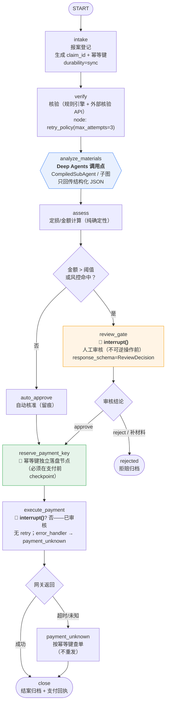

# R3 框架基线：LangGraph 确定性流程 × Deep Agents 分工

- **文档状态**：基线（v1，attempt 2 定稿）
- **撰写**：flow-engineer（AgentTeams `insurance-intel-2026`）
- **撰写时间**：2026-11-17 ~ 2026-11-18（Asia/Shanghai）
- **适用下游**：t9（架构设计）、t10（流程实现）、F1/F2
- **硬规则遵从**：本文件每条结论都标注了 **外部来源（URL + 访问时间）** 或 **本机实测证据（命令 + 落盘文件）**；未出现"凭记忆"的 API 断言。凡本机实测与文档冲突，以实测为准并单独标注。

> **交付根（队长 2026-11-18 裁决）**：唯一交付根 = `renewal-assistant/`（方案 C）。本文件 = `renewal-assistant/docs/research/r3-langgraph-deepagents.md`；证据 = `renewal-assistant/docs/research/evidence/`（23 文件）；日志 = `renewal-assistant/docs/log/step-r3.md`。`homework5/insurance-agent/` 是创建团队时的旧口径，**已删除，后续不得再新建**。

---

## 0. 结论速览（TL;DR，给 t9/t10 直接照做）

| # | 结论 | 依据 |
|---|---|---|
| 1 | **LangGraph 1.2.20（本机已装）**：`interrupt(value, *, response_schema=None)` + `Command(resume=...)` 是当前唯一官方 HITL 写法；`interrupt()` 的返回值就是 `Command(resume=X)` 里的 `X` | 实测签名 `evidence/probe-introspect.txt`；官方 [Interrupts](https://docs.langchain.com/oss/python/langgraph/interrupts) §Pause using `interrupt` |
| 2 | 节点在 resume 时**从函数第一行重跑**，`interrupt()` 之前的副作用会重复执行 → 支付类副作用必须放在 `interrupt()` **之后**、且幂等 | `evidence/mdx/lg-interrupts.mdx:1019`（Rules of interrupts）、`:1365`（Side effects before `interrupt` must be idempotent） |
| 3 | **幂等键必须来自"已经持久化"的状态**，不能在同一个节点里生成后依赖返回值；官方给的做法是独立节点 `reserve_key` 先落盘，配合 `durability="sync"` | `evidence/mdx/lg-fault-tolerance.mdx:277-341` |
| 4 | **SqliteSaver 跨进程恢复已实测通过**：进程 A 停在 `interrupt`，进程 B 新解释器 `get_state()` 拿回 `next=('review',)`，`Command(resume=True)` 续跑，`intake` 节点**没有重跑** | `evidence/probe-phase1.txt`、`evidence/probe-phase2.txt`（命令见 §3.4） |
| 5 | `recursion_limit` 是**运行次数上限**（super-step 计数），默认 **10,007**（≥1.1.4）；超限抛 `GraphRecursionError`，实测 `recursion_limit=7` 立即触发 | `evidence/mdx/lg-graph-api.mdx:649`、`evidence/mdx/lg-graph-api-control-flow.mdx:518`、`evidence/probe-recursion.txt` |
| 6 | **Deep Agents 就是一个 LangGraph 图**：`create_deep_agent(...) -> CompiledStateGraph`。官方原话："`deepagents` is a standalone library built on top of LangChain's core building blocks … It uses the **LangGraph runtime** for durable execution, streaming, human-in-the-loop" | 源码 `evidence/deepagents-graph.py:296-316`；`evidence/mdx/da-overview.mdx`（Self-host with the SDK 段） |
| 7 | **集成推荐拓扑**：Deep Agents **作为 LangGraph 子图/节点内的一次调用**（材料分析），业务决策与状态机**留在外层 StateGraph**。官方"Choose the unit of work"表明确支持"子图 = 有自己路由/状态、可复用"这种用法 | `evidence/mdx/lg-graph-api.mdx`（Choose the unit of work 表，`### Choose the unit of work` 段）；`da-going-to-production.mdx:242` |
| 8 | **Deep Agents 未安装在本机**：`deepagents` 最新版 **0.7.39**（PyPI 上传 2026-11-16T15:55:09）；安装会 **新增 13 个包、改动 2 个**（`langchain-core 1.8.0→1.8.1`、`tenacity 9.2.1→9.1.4` 降级）→ **需队长批准，命令见 §5.2** | `evidence/pypi-deepagents-0.7.39.json`；`uv pip install --dry-run` 输出（§5.2） |
| 9 | **版本无硬冲突**：`deepagents 0.7.39` → `langchain>=1.5.0` → `langgraph>=1.2.12,<1.3.0`，本机 `langgraph 1.2.20` 落在区间内；唯一需要接受的是 `langchain-core` 补丁级上升与 `tenacity` 小版本下降 | §5.2 版本矩阵（PyPI JSON 实测） |

---

## 1. 来源清单（≥3 个互相独立来源，全部为本次实际访问）

| # | 来源 | URL | 访问时间（Asia/Shanghai） | 版本/时间戳 | 影响了哪项设计 |
|---|---|---|---|---|---|
| S1 | LangChain 官方文档 · LangGraph Interrupts | https://docs.langchain.com/oss/python/langgraph/interrupts | 2026-11-17 23:19 / 23:55（MDX 源） | 页面无版本号；文档源 `langchain-ai/docs@main` | `interrupt()` 语义、resume 重跑、幂等要求、子图 interrupt 语义 |
| S2 | LangChain 官方文档 · LangGraph Checkpointers（含 Durability modes） | https://docs.langchain.com/oss/python/langgraph/checkpointers | 2026-11-17 23:55 | 同上 | `SqliteSaver`、`durability` 三档、thread_id、checkpoint 存储 |
| S3 | LangChain 官方文档 · LangGraph Fault tolerance | https://docs.langchain.com/oss/python/langgraph/fault-tolerance | 2026-11-17 23:55 | 同上 | `RetryPolicy`、`error_handler`、幂等键、`interrupt` 不进 error handler |
| S4 | LangChain 官方文档 · Graph API（recursion limit / re-execution / unit of work） | https://docs.langchain.com/oss/python/langgraph/graph-api | 2026-11-18 00:00 | 同上 | 默认 10,007、节点=checkpoint 边界、子图 vs task 选择 |
| S5 | LangChain 官方文档 · Use subgraphs | https://docs.langchain.com/oss/python/langgraph/use-subgraphs | 2026-11-17 23:55 | 同上 | 子图 checkpointer 继承、`checkpointer=False` 无中断 |
| S6 | LangChain 官方文档 · Deep Agents Overview | https://docs.langchain.com/oss/python/deepagents/overview | 2026-11-18 00:00 | 同上 | "deepagents 用 LangGraph runtime"、todo planning opt-in (v0.7)、filesystem 后端 |
| S7 | LangChain 官方文档 · Deep Agents Subagents | https://docs.langchain.com/oss/python/deepagents/subagents | 2026-11-18 00:00 | 同上 | `subagents=`、`task` 工具、general-purpose 默认子代理 |
| S8 | LangChain 官方文档 · Deep Agents Human-in-the-loop | https://docs.langchain.com/oss/python/deepagents/human-in-the-loop | 2026-11-18 00:00 | 同上 | `interrupt_on`、decision 顺序、必须 checkpointer |
| S9 | LangChain 官方文档 · Deep Agents Context engineering | https://docs.langchain.com/oss/python/deepagents/context-engineering | 2026-11-18 00:00 | 同上 | 20000 token offload、85% 摘要、子代理隔离降 token |
| S10 | LangChain 官方文档 · Deep Agents Going to production | https://docs.langchain.com/oss/python/deepagents/going-to-production | 2026-11-18 00:00 | 同上 | Deep Agents 的 durability/guardrails/支付类不可逆操作措辞 |
| S11 | **GitHub 源码** `langchain-ai/deepagents` graph.py（main） | https://raw.githubusercontent.com/langchain-ai/deepagents/main/libs/deepagents/deepagents/graph.py | 2026-11-18 00:05 | 仓库 `main`；与 0.7.39 语义一致（见 §5.3 说明） | `create_deep_agent` 完整签名 + 参数语义（唯一权威） |
| S12 | **PyPI JSON API** · deepagents 0.7.39 | https://pypi.org/pypi/deepagents/0.7.39/json | 2026-11-18 00:02 | 上传时间 `2026-11-16T15:55:09`，`requires_python <4.0,>=3.11` | 版本号、依赖约束（**版本号禁止来自记忆**） |
| S13 | **PyPI JSON API** · langgraph 1.2.20 | https://pypi.org/pypi/langgraph/1.2.20/json | 2026-11-18 00:20 | 上传时间 `2026-11-05T02:20:37` | langgraph 依赖区间 |
| S14 | **PyPI JSON API** · langchain 1.5.0 | https://pypi.org/pypi/langchain/1.5.0/json | 2026-11-18 00:20 | 上传时间 `2026-11-11T15:47:07`；要求 `langgraph>=1.2.12,<1.3.0` | 证明 deepagents↔本机 langgraph 无冲突 |
| S15 | LangChain 官方文档 · Workflows and agents | https://docs.langchain.com/oss/python/langgraph/workflows-agents | 2026-11-17 23:55 | 文档源 main | 官方"workflow（预定代码路径）vs agent（自定流程）"的边界口径（回答反例问题） |

**落盘证据目录**：`renewal-assistant/docs/research/evidence/`
- `mdx/*.mdx`：S1-S10、S15 的**原文源码**（LangChain 文档仓库的 `.mdx`，比渲染页更精确，含行号）
- `deepagents-graph.py`：S11 原文
- `pypi-*.json`：S12-S14 原始 API 响应
- `probe-introspect.txt` / `probe-phase1.txt` / `probe-phase2.txt` / `probe-recursion.txt` / `probe-durability.txt`：本机实测输出
- `probe_langgraph_api.py`：产生上述输出的探针脚本（非生产代码）
- `lg-interrupts.html` / `persistence.html` / `graph-api.html` / `overview.html` / `use-subgraphs.html`：渲染页存档（冗余备份）

> 说明：`docs.langchain.com` 的 `.../langgraph/durable-execution` 已**重定向**到 Persistence 页（实测：请求该 URL 返回标题 "Persistence"），因此 durability 三档的权威出处是 `checkpointers` 页的 §Durability modes（S2），而不是一个独立的 durable-execution 页。这一点已按实测修正，未沿用记忆中的旧页面结构。

---

## 2. LangGraph 1.2.20：实测版本矩阵与 API 签名

**命令**（可复现）：

```bash
cd /Users/leoms/Documents/deepseek-harness-workspace/homework5
renewal-assistant/.venv/bin/python renewal-assistant/docs/research/evidence/probe_langgraph_api.py introspect
```

**实测输出（`evidence/probe-introspect.txt`，摘录）**：

```
langgraph==1.2.20
langgraph-checkpoint==4.3.1
langgraph-checkpoint-sqlite==3.1.3
langgraph-prebuilt==1.1.1
langchain-core==1.8.0
aiosqlite==0.22.1

interrupt(value: 'Any', *, response_schema: 'dict[str, Any] | type | None' = None) -> 'Any'
Command(*, graph: 'str | None' = None, update: 'Any | None' = None,
        resume: 'dict[str, Any] | Any | None' = None, goto: ...) -> None
SqliteSaver.__init__(self, conn: 'sqlite3.Connection', *, serde: 'SerializerProtocol | None' = None)
StateGraph.add_conditional_edges(self, source: str, path, path_map: 'dict[Hashable, str] | list[str] | None' = None)
StateGraph.add_node(self, node, action=None, *, defer=False, metadata=None, input_schema=None,
                    retry_policy: 'RetryPolicy | Sequence[RetryPolicy] | None' = None,
                    cache_policy=None, error_handler=None, destinations=None,
                    timeout: 'float | timedelta | TimeoutPolicy | None' = None, ...)
StateGraph.compile(self, checkpointer=None, *, cache=None, store=None,
                   interrupt_before=None, interrupt_after=None, debug=False, name=None, transformers=None)
RetryPolicy(initial_interval=0.5, backoff_factor=2.0, max_interval=128.0,
            max_attempts=3, jitter=True, retry_on=<function default_retry_on>)
TimeoutPolicy(*, run_timeout=None, idle_timeout=None, refresh_on='auto')
CompiledStateGraph.invoke(..., durability: 'Durability | None' = None, ...)
CompiledStateGraph.get_state(self, config, *, subgraphs: bool = False) -> StateSnapshot
Interrupt fields: {'value': 'Any', 'id': 'str', 'response_schema': 'type[ResponseT] | dict[str, Any] | None'}
```

**要点（对 t10 有直接约束）**：

1. `interrupt()` 第一个位置参数是 payload（任意 JSON 可序列化值），`response_schema` 是**关键字参数**，且需 `langgraph>=1.2.12`（本机 1.2.20 ✅）——官方 S1 §Define an interrupt response schema。
2. `Command` 是 `@dataclass(frozen=True)` 风格的关键字构造：`Command(resume=X)`、`Command(goto="n")`、`Command(update={...})`。官方明确：**`resume` 是 `invoke()` 的唯一合法 Command 用法**，`update/goto` 只在节点 return 时用（S1 §Resuming interrupts）。
3. `add_conditional_edges(source, path, path_map)`：`path_map` 可以是 `dict[label, node]`（推荐，显式）或 `list[str]`。
4. `add_node(..., retry_policy=..., error_handler=..., timeout=..., cache_policy=...)` —— 重试/错误/超时全部是**节点级**参数（`error_handler`、`timeout` 需 `langgraph>=1.2`，本机满足）。
5. `invoke(..., durability="sync"|"async"|"exit")` 是**调用时**参数；`compile(checkpointer=...)` 决定是否有 checkpoint。
6. 探针中一处**本机行为细节**（非文档断言）：无 checkpointer 时传 `durability="sync"` 会抛 `AttributeError: 'SyncPregelLoop' object has no attribute '_put_checkpoint_fut'`，但只发 `UserWarning: durability has no effect when no checkpointer is present`；`durability="bogus"` 被静默接受（无校验）。→ **实现约束：durability 只在挂了 checkpointer 时使用，且只传三档合法值**（`evidence/probe-durability.txt`）。

---

## 3. 确定性业务流程的推荐写法（对应任务卡第 2 点）

### 3.1 `interrupt()` 做人工审核（唯一官方 HITL 原语）

来源：S1（`evidence/mdx/lg-interrupts.mdx:36` §Pause using `interrupt`，`:85` §Resuming interrupts，`:391` §Approve or reject，`:1019` §Rules of interrupts）。

必须遵守的三条硬规则（每条都有出处）：

| 规则 | 出处 | 我们的落地 |
|---|---|---|
| **不要用 try/except 包住 `interrupt()`**（它靠抛 `GraphInterrupt` 异常暂停，被吞掉就永不暂停） | `lg-interrupts.mdx:1026` §Do not wrap `interrupt` calls in try/except | 审核节点内把 `interrupt()` 放在最前面，业务 try/except 只包后续 IO |
| **同一节点内 `interrupt()` 的调用顺序必须稳定**（resume 值按**索引**匹配） | `lg-interrupts.mdx:1127` §Do not reorder `interrupt` calls within a node | 一个节点最多一个 `interrupt()`；需要多次审核 → 拆成多个节点（`review_underwrite` / `review_payment`） |
| **`interrupt()` 之前不要放副作用**；必须放就做成幂等（upsert） | `lg-interrupts.mdx:1365` §Side effects called before `interrupt` must be idempotent | 审核节点只写"审核意见"到 state；写库/发通知放审核**之后**的独立节点 |

补充：`interrupt()` 的 payload 会以 `result["__interrupt__"][0]`（`invoke`）或 `stream.interrupts`（`stream_events(version="v3")`）返回；`Interrupt` 结构为 `{value, id, response_schema}`（实测字段，`probe-introspect.txt`）。

### 3.2 幂等键：位置与时序（支付类不可逆操作的命门）

来源：S3 §Retry boundaries and idempotency（`lg-fault-tolerance.mdx:277`、`:290`、`:336`、`:373`）+ S4 §Re-execution and idempotency（`lg-graph-api.mdx:334`）。

官方给出的**错误示范**（`lg-fault-tolerance.mdx:290` 附近）：

```
attempt 1: node starts -> generate key K1 -> charge succeeds -> process dies before returning
attempt 2: node starts -> state has no key -> generate key K2 -> charge runs again
```

官方**正确做法**（同段代码示例）：

```python
def charge_customer(state: State) -> dict:
    # 从"已经持久化"的状态派生，重试/resume 都会得到同一个键
    idempotency_key = f"charge:{state['order_id']}"
    provider.charge(..., idempotency_key=idempotency_key)
    return {"last_payment_key": idempotency_key, "charged": True}   # 仅用于观测
```

当业务上没有天然唯一标识时，官方要求**用一个独立节点先把 key 落盘**，且必须 `durability="sync"` 才在崩溃场景下可靠（`lg-fault-tolerance.mdx:336` 原文："When no durable business identity exists, persist a generated key in its own node before the side effect. Across a process crash, that only works if the intervening checkpoint is durable. Use sync durability for that pattern."）：

```python
def reserve_key(state: State) -> dict:
    return {"payment_key": state.get("payment_key") or str(uuid.uuid4())}

def charge_customer(state: State) -> dict:
    provider.charge(..., idempotency_key=state["payment_key"])
    return {"charged": True}
```

→ **本项目的键设计（给 t10）**：`payment_idempotency_key = sha256(claim_id + policy_no + approved_amount + approval_version)`，由 `reserve_payment_key` 节点写进 state 并 checkpoint；`execute_payment` 节点只读不生成。**绝不在 `execute_payment` 内生成**。

官方还提醒：**"缺失的 ACK 视为未知，而非未发生"**（`lg-fault-tolerance.mdx:373`）——支付网关超时时必须"查单"（query by idempotency key）再决定补偿，不允许直接重发。

### 3.3 retry policy / 节点失败边界

来源：S3 §Retries（`lg-fault-tolerance.mdx:64`）、§Error handling（`:698`）、§Behavior with `interrupt()`（`:959`）、§Subgraph failures（`:965`）。

| 机制 | 关键事实 | 出处行 |
|---|---|---|
| `RetryPolicy(max_attempts=3, retry_on=...)` | 默认 `retry_on=default_retry_on`：**不重试** `ValueError/TypeError/OSError/RuntimeError/...`；HTTP 只重试 5xx；`NodeTimeoutError` 默认可重试 | `:97`、`:141` |
| `error_handler=`（NodeError → Command） | 重试**耗尽后**运行，可 `Command(update=..., goto=...)` 做 Saga 补偿；`lanaggraph>=1.2` 才有 | `:698` |
| **`interrupt()` 不会被 retry / error_handler 捕获** | 原文："`interrupt()` raised inside a node is **not** routed to the error handler … bypassing both retry policies and error handlers" | `:959` |
| 子图异常冒泡到父节点 | 父节点有 `error_handler` 时以子图异常为 `error.error` 触发 | `:965` |
| 失败溯源被 checkpoint | 崩溃后 resume，handler 看到同一个 `NodeError` | `:953` |

→ **本项目边界**：`verify`（外部核验 API）挂 `RetryPolicy(max_attempts=3, retry_on=(ConnectionError, TimeoutError))`；`execute_payment` **不挂 retry**（改为 `error_handler` → 进 `payment_unknown` 分支查单），避免重复扣款；`interrupt` 审核节点**不挂 retry**（无意义，且不会生效）。

### 3.4 SQLite checkpointer 跨进程恢复语义 + 已知坑（对应队长问题 2）

**实测方法**（两个独立进程，验证真实崩溃/重启语义，而不是同进程 resume）：

```bash
P=renewal-assistant/docs/research/evidence
renewal-assistant/.venv/bin/python $P/probe_langgraph_api.py cleanup
renewal-assistant/.venv/bin/python $P/probe_langgraph_api.py phase1   # 进程 A：跑到 interrupt 停下
renewal-assistant/.venv/bin/python $P/probe_langgraph_api.py phase2   # 进程 B：全新解释器，resume
```

**实测结果**：

```
# phase1（evidence/probe-phase1.txt）
phase1 interrupts: [('Interrupt', '73ce11e00b61a70604ff73e7e7981e62', {'question': 'Approve claim payout?', 'claim_id': 'C1', 'evidence_summary': 'crash report + photos'})]
phase1 next: ('review',)
phase1 state: {"claim_id": "C1", "policy_no": "P-1", "evidence_summary": "crash report + photos", "trace": ["intake"]}
phase1 checkpoint_id: 1f1e29a7-7ff3-6ad8-8001-0de7938e157f
DB size: 4096

# phase2（evidence/probe-phase2.txt）—— 全新进程
phase2 (fresh process) recovered next: ('review',)
phase2 recovered state: {"claim_id": "C1", ..., "trace": ["intake"]}
phase2 final state: {..., "approved": true, "paid": true, "trace": ["intake", "review", "pay"]}
phase2 intake ran again? ['intake', 'review', 'pay']
```

**结论（可以直接写进 t10 的验收）**：
1. `SqliteSaver(sqlite3.connect(path))` 在**进程重启后**能恢复 `next`（待执行节点）与完整 state ✅。
2. resume 时**已完成的节点不会重跑**（`intake` 在 trace 里只出现一次）✅；只有**被中断的那个节点**从函数头重跑（`review` 重跑，符合 §3.1 第一条）。
3. 恢复靠 `thread_id`；`get_state(config)` 即可查看 `next`/`values`/`checkpoint_id`（`StateSnapshot`）。

**已知坑（官方 + 实测）**：

| 坑 | 影响 | 处置 | 出处 |
|---|---|---|---|
| `MemorySaver/InMemorySaver` 重启即丢 | 演示能过、重启全没 | 生产/交付用 `SqliteSaver`（本项目） | S2 页 §`MemorySaver` does not persist between restarts |
| `durability` 与"第一次 checkpoint"的关系：`exit` 模式跑完才落盘，崩溃时线程完全无记录；`sync` 才会在第一个用户节点前提交 input checkpoint | 崩溃后无法区分"从未受理"与"受理了但丢了" | 派单入口用 `durability="sync"`；必要时另写 outbox 行 | `lg-checkpointers.mdx:640-676` §First durable checkpoint on a new thread |
| `thread_id` 过长（PostgresSaver 场景） | DB 报错 | 用 UUID/短哈希，<255 字符 | S2 页 §Troubleshooting |
| checkpoint 无限增长 | 延迟/磁盘 | 定期 prune | S2 页 §Checkpoints growing unboundedly |
| 子图与父图各管自己的 checkpoint 命名空间 | 父图看不到子图即时更新 | 需要跨边界数据时用 Store 或显式回传 | S2 页 §State access from parent graph to subgraph；S5 `lg-use-subgraphs.mdx:615` |
| `SqliteSaver.list(None)`：传 `{}` 会当线程过滤器并报错 | 列举全部线程失败 | 传 `None`（或 async 用 `.alist(None)`） | `lg-checkpointers.mdx:598` |
| SQLite 并发写 | 多 worker 抢锁 | 本项目单进程串行执行；如并行需 WAL + 单写者 | 实测环境（单连接 `check_same_thread=False`） |

---

## 4. `recursion_limit`（对应任务卡第 1 点）

来源：S4 `lg-graph-api.mdx:649`、`lg-graph-api-control-flow.mdx:518`。

- 语义：**一次 run 允许执行的 super-step 数上限**，超限抛 `GraphRecursionError`。
- 默认值：**≥1.1.4 为 10,007**；1.0.6–1.1.3 为 10,000（`lg-graph-api.mdx:649`）。
- 覆盖方式：`config={"recursion_limit": N}` —— 是**顶层 config 键**，不是 `configurable` 下（`lg-graph-api.mdx:649` 原文 "pass `recursion_limit` as a top-level config key (not under `configurable`)"）；也可用环境变量 `LANGGRAPH_DEFAULT_RECURSION_LIMIT`。
- 实测：`recursion_limit=7` → 立刻 `GraphRecursionError: Recursion limit of 7 reached without hitting a stop condition`（`evidence/probe-recursion.txt`）。
- **注意**：这是**整个 run（含子图/agent 内循环）**的预算，不只是外层节点数。→ 长程材料分析会吃这个预算，必须显式设定（见 §6.3）。

---

## 5. Deep Agents：版本、依赖、API（对应任务卡第 3 点 + 队长问题 3）

### 5.1 包名与定位（官方原话）

- 包名 **`deepagents`**（PyPI），Python：`requires_python = <4.0,>=3.11`（S12）。
- 官方定位（S6 §Self-host with the SDK）：*"**`deepagents`** is a standalone library built on top of **LangChain**'s core building blocks for agents. It uses the **LangGraph runtime** for durable execution, streaming, human-in-the-loop, and other features."*
- **它内部就是一个 LangGraph 图**：`create_deep_agent(...)` 的返回类型签名就是 `CompiledStateGraph[AgentState[ResponseT], ContextT, InputAgentState, OutputAgentState[ResponseT]]`（S11 `deepagents-graph.py:316`）。
- 官方摘要（S12 `summary` 字段原文）："Production-ready, extensible agent harness with a built-in filesystem and context management, sub-agent delegation, skills, and long-term memory."

### 5.2 版本、安装方式与依赖冲突评估（队长要求：先查实际版本，不许写记忆）

**实际版本查询**（两条独立证据，均为本次访问）：

```bash
renewal-assistant/.venv/bin/python -m pip index versions deepagents | head -3
# deepagents (0.7.39)  ← 最新；Available versions 从 0.7.39 回溯到 0.0.1（共 100+）

curl -sSL https://pypi.org/pypi/deepagents/0.7.39/json | python3 -c "import json,sys; d=json.load(sys.stdin); print(d['info']['version'], d['urls'][0]['upload_time'])"
# 0.7.39 2026-11-16T15:55:09
```

**依赖实测**（S12 `requires_dist`）：

```
langchain<2.0.0,>=1.5.0
langchain-core<2.0.0,>=1.8.1        ← 本机是 1.8.0（差一个补丁位）
langchain-anthropic<2.0.0,>=1.7.10
langchain-google-genai<5.0.0,>=4.4.3
langsmith>=0.14.17
packaging>=23.2
wcmatch>=11.0
[aws] langchain-aws<2.0.0,>=1.9.3
[quickjs] langchain-quickjs>=0.3.12
[video] av>=18.0.0, pillow>=12.3.0
```

**注意：`requires_dist` 里没有直接 `langgraph` 约束**，它经 `langchain` 传递：

| 包 | 版本（实测） | 关键约束 | 来源 |
|---|---|---|---|
| langgraph | 1.2.20（上传 2026-11-05T02:20:37） | `langchain-core<2,>=1.4.7`、`langgraph-checkpoint<5,>=4.3.0` | S13 |
| langchain | 1.5.0（上传 2026-11-11T15:47:07） | **`langgraph<1.3.0,>=1.2.12`**、`langchain-core<2,>=1.8.0` | S14 |
| deepagents | 0.7.39（上传 2026-11-16T15:55:09） | `langchain>=1.5.0`、`langchain-core>=1.8.1` | S12 |

→ **无硬冲突**：`1.2.20` 满足 `>=1.2.12,<1.3.0`。

**安装模拟（dry-run，未实际安装）**：

```bash
uv pip install --dry-run --python renewal-assistant/.venv/bin/python deepagents
# Resolved 56 packages in 4.38s ; Would install 13 packages ; Would uninstall 2 packages
#  + deepagents==0.7.39, langchain==1.5.0, langchain-anthropic==1.7.10,
#    langchain-google-genai==4.5.0, google-genai==3.4.0, google-auth==2.62.2,
#    wcmatch==12.0.3, bracex==3.2.3, filetype==1.2.0, pyasn1==0.6.5, pyasn1-modules==0.4.2
#  - langchain-core==1.8.0  →  + langchain-core==1.8.1     （补丁级上升）
#  - tenacity==9.2.1        →  + tenacity==9.1.4           （小版本下降，⚠️）
```

**结论与请求（队长明确要求：先报告再动手）**：

- 本机 `deepagents` **未安装**（`pip show deepagents` 无记录；§5.2 前两条为 `pip index versions` 的远端查询，不代表已装）。
- 安装**若批准**，建议命令（隔离、可回滚，且不动现有 venv 主锁）：
  ```bash
  # 方案 1（推荐）：放进独立 venv，避免影响 renewal-assistant 既有依赖
  uv venv .venv-claims --python 3.12
  uv pip install --python .venv-claims/bin/python deepagents==0.7.39
  # 方案 2：装进既有 venv（会升级 langchain-core 到 1.8.1、降级 tenacity 到 9.1.4）
  uv pip install --python renewal-assistant/.venv/bin/python "deepagents==0.7.39"
  ```
- ⚠️ **风险点**：`tenacity 9.2.1 → 9.1.4` 是**降级**，`langchain-core` 补丁位变化可能影响既有 `renewal-assistant` 的 30+ 测试。
- ✅ **缓解**：`claims` 子域如果只用 `deepagents` 做**材料分析子图**，可以把 deep agent 放在**可选项**后面（`DEEPAGENTS_ENABLED=1` 才 import），主流程（报案→核验→审核→支付）零依赖它；这样既满足"Deep Agents 承担长程材料分析"，又不会为了 demo 把续保系统搞坏。**建议 t9 采纳此降级开关设计**。

### 5.3 `create_deep_agent` 签名（S11，唯一权威；逐参数）

```python
def create_deep_agent(
    model: str | BaseChatModel | None = None,
    tools: Sequence[BaseTool | Callable | dict[str, Any]] | None = None,
    *,
    system_prompt: str | SystemMessage | None = None,
    middleware: Sequence[AgentMiddleware] = (),
    subagents: Sequence[SubAgent | CompiledSubAgent | AsyncSubAgent] | None = None,
    skills: list[str] | None = None,
    memory: list[str] | None = None,
    permissions: list[FilesystemPermission] | None = None,
    backend: BackendProtocol | None = None,
    interrupt_on: dict[str, bool | InterruptOnConfig] | None = None,
    response_format: ResponseFormat | type | dict | None = None,
    state_schema: type[DeepAgentState] | None = None,
    context_schema: type[ContextT] | None = None,
    checkpointer: Checkpointer | None = None,
    store: BaseStore | None = None,
    debug: bool = False,
    name: str | None = None,
    cache: BaseCache | None = None,
) -> CompiledStateGraph[...]
```
（`evidence/deepagents-graph.py:296-316`）

| 参数 | 关键语义（官方 docstring 原文要点） | 行号 |
|---|---|---|
| `model` | `provider:model` 字符串（如 `openai:gpt-5.5`）或 `BaseChatModel`；**`model=None` 自 0.5.3 起 deprecated，1.0.0 移除** | `:329-346` |
| `tools` | **叠加**到内置工具集（`ls/read_file/write_file/edit_file/glob/grep` + `execute` + `task`），不能删除内置工具 | `:359-369` |
| `subagents` | 三种形态：`SubAgent`（声明式字典）、`CompiledSubAgent`（预编译 runnable）、`AsyncSubAgent`（远端/后台）。**经 `task` 工具调用**；未指定 `general-purpose` 时会自动加一个 | `:499-540` 附近（docstring `subagents:` 段） |
| `backend` | 文件存储/执行后端（`StateBackend()` 默认；`FilesystemBackend(root_dir=...)` 落盘；支持 `SandboxBackendProtocol` 才可 `execute`） | docstring `backend:` 段 |
| `interrupt_on` | `{tool_name: True | InterruptOnConfig}`，**HITL 的官方入口**；`permissions` 里的 `mode="interrupt"` 会自动装 `HumanInTheLoopMiddleware` | docstring `interrupt_on:` 段 |
| `state_schema` | 必须是 `DeepAgentState` 的 `TypedDict` 子类；会转发给声明式子代理（并行 `task` 写同字段需 reducer，否则 `InvalidUpdateError`） | `:561-590` |
| `checkpointer` | 透传 `create_agent`；**HITL 必需** | `:600-604` |
| `response_format` | 结构化输出（给外面回传结构化 JSON 用） | `:557` 附近 |

### 5.4 子代理（subagents）怎么在"流程内部"被调用（队长问题 4）

官方机制（S7 `da-subagents.mdx:63` 的 mermaid 与 `:355-360`）：

```
Main[Main Agent] --|task tool|--> Sub[Subagent]
```

- **调用方式：作为工具调用**（`task` 工具），**不是** LangGraph 节点。主 agent 可以在**同一轮发起多个 `task` 并行**（`da-subagents.mdx:360`）。
- 只有存在同步子代理时，`SubAgentMiddleware` + `task` 工具才会被挂上；否则没有委派能力（`da-subagents.mdx:105-112`）。
- 子代理三种形态：`SubAgent`（dict：`name`/`description`/`system_prompt`/`tools`/`model`/`interrupt_on`/`skills`/`permissions`/`response_format`）、`CompiledSubAgent`（`runnable` 预编译）、`AsyncSubAgent`（`graph_id` + 可选 `url`/`headers`）。
- 子代理的价值（`da-subagents.mdx:76-88`）：**上下文隔离**——主 agent 只拿到最终结论，不拿到子代理那几十次工具调用的中间结果。
- 何时**不**用（官方明确列出，`da-subagents.mdx:84-88`）：单步简单任务、需要保留中间上下文、开销大于收益。
- 最佳实践（`:663-728`）：描述要具体、工具集最小化、按任务选模型、**要求子代理返回摘要而非原始数据**。

→ **本项目落地**：核验阶段的材料分析用**一个** `SubAgent`（`name="evidence-analyst"`）已足够；如需"二级扇出孙 Agent"，在 `SubAgent` 自己的 `tools` 里再挂 `task`（`mode="fork"` 是实验特性，慎用，`da-subagents.mdx:202-295`）。

### 5.5 文件系统后端 / planning(todo) / 上下文管理（对应任务卡第 3 点）

| 能力 | 官方事实 | 出处 |
|---|---|---|
| 虚拟文件系统 | 后端可插拔：内存 state / 本地磁盘 / LangGraph store / 组合路由 / 自定义（带权限规则）。工具：`ls` `read_file` `write_file` `edit_file` `glob` `grep`（+ 沙箱后端的 `execute`） | `da-overview.mdx:131-160` |
| **planning（todo）** | **v0.7 起是 opt-in**：默认**不再**内置 task planning middleware；要用 `write_todos` 需显式传 `TodoListMiddleware` 到 `middleware=` | `da-overview.mdx:319-342` |
| 上下文压缩（自动，无需配置） | ① **Offloading**：工具输入/结果 > **20,000 token** 时落盘换引用；上下文过 85% 窗口时截断旧 tool call 换为文件指针 ② **Summarization**：过 85% `max_input_tokens` 时 LLM 摘要；保留 10% 最近上下文；模型 profile 缺失时回退 170,000 token 触发/保留 6 条；遇 `ContextOverflowError` 立即摘要重试 | `da-context-engineering.mdx:228-300` |
| 子代理做上下文隔离 | 主 agent 只收最终报告 | `da-context-engineering.mdx:351-370` |

### 5.6 Deep Agents 自带 HITL（与 LangGraph `interrupt` 是同一套运行时）

来源：S8。要点：

- `interrupt_on={"edit_file": True}` → 暂停在该工具调用前；decision 类型 `approve / edit / reject / respond`（Python 四种），可用 `allowed_decisions` 收紧（`da-human-in-the-loop.mdx:66-140`）。
- **必须挂 checkpointer**（`:921`），**必须用同一个 `thread_id`** resume（`:937`）。
- resume 载荷形状：`Command(resume={"decisions": [...]})`，`decisions` 顺序必须与 `interrupt_value["action_requests"]` **一一对应**（`:950`）。
- 拒绝时给 `message` 说明"未执行、不要重试"（`:461` §Rejection messages）。
- 风险分级配置（`:971` §Tailor configurations by risk）：支付类只给 `["approve","reject"]`，不要给 `edit`（避免编辑参数引发重复执行，官方 Tip 明确警告）。

### 5.7 Deep Agents 已知坑与成本（对应任务卡第 5 点 + 队长问题 6 铺垫）

| 坑 | 事实/出处 | 我们的对策 |
|---|---|---|
| **模型能力门槛** | "Deep Agents work with any LangChain chat model that supports **tool calling**"；官方给的"表现良好"清单是 gemini-3.1-pro / gpt-5.5 / claude-opus-4-8 / GLM-5.2 等**前沿模型**，且"通过 eval 是必要非充分"（`da-models.mdx` §Supported/Suggested models） | 材料分析固定用较强模型；禁用 `model=None`（已 deprecated，`graph.py:331-346`） |
| **token 成本** | 每次 `create_deep_agent` 都内置 Summarization/Offloading，摘要本身要**再调一次 LLM**；可用更便宜 `summarizer=`（需 `deepagents>=0.7.26`，`da-context-engineering.mdx:266-300`） | 限制子代理轮次 + `response_format` 强约束输出 + 只把结构化结论回传主图 |
| **轮次失控** | agent 是"自定流程"，没有天然步数上限；外层靠 `recursion_limit`（`lg-graph-api.mdx:649`）；子代理可用 `CompiledSubAgent` 自己包 `recursion_limit` | 外层 `recursion_limit` 显式设定 + `SubAgent` 提示词写明"最多 N 轮工具调用后必须产出结论" |
| **`execute` 工具的隐含要求** | 只有实现 `SandboxBackendProtocol` 的后端才能跑 shell；否则 `execute` 返回错误信息（`graph.py:319-327` docstring） | 材料分析用 `FilesystemBackend`（只读写，不执行 shell） |
| **planning 默认关闭** | v0.7 起 todo 需显式 `TodoListMiddleware`（`da-overview.mdx:326`） | 长程分析场景显式开；简单场景不开，省 token |
| **`interrupt_on` 不继承到 `CompiledSubAgent`** | `CompiledSubAgent` 与 `AsyncSubAgent` **不继承**顶层 `interrupt_on`，须在 runnable 内部自己配（`graph.py` docstring `interrupt_on:` 段） | 若我们自定义编译子图，审核点自己 `interrupt()` |
| **多租户/凭证** | 官方有专门章节（`da-going-to-production.mdx:151-228`） | 单租户 demo 不涉及；记录备查 |

---

## 6. 两者集成的官方推荐（对应任务卡第 4 点 + 队长问题 4）

### 6.1 关键判断：deep agent 是"图"，所以两种嵌法都合法，但官方给出了选择标准

官方原话（S4 `lg-graph-api.mdx` §Choose the unit of work）：

| 原语 | 自有 checkpoint | resume 行为 | **什么时候选它** |
|---|---|---|---|
| 节点内的普通函数 | 否 | 随节点重跑 | 该步之后没有路由分叉，且整体重跑可接受 |
| `task`（functional API） | 否（结果随父 entrypoint 存） | 父重放，已完成 task 返回缓存结果 | 有副作用或昂贵，**不能**在 resume 时重复 |
| **子图（Subgraph）** | 是（stateful 模式下挂在父线程命名空间下） | 在子图内部停在中断/失败的那个节点 | **该单元有自己的路由/状态 schema，或会被多个父图复用** |
| 图节点 | 是（super-step 后写 checkpoint） | 从该节点恢复 | 之后可能有路由分叉，或需要 interrupt/resume/time-travel 边界 |

（同页还有一句对 t10 很重要：*"Deterministic work such as parsing, retrieval, or a fixed tool chain **does not need its own node** unless you want that boundary."*）

子图持久化三档（S5 `lg-use-subgraphs.mdx:615-630`）：`checkpointer=None`（**默认，per-invocation**：继承父 checkpointer，**支持 `interrupt()`**）／`checkpointer=True`（per-thread，长期记忆）／`checkpointer=False`（**无 checkpoint，无 interrupt**）。原文 `:630`：*"The parent graph must be compiled with a checkpointer for subgraph persistence features (interrupts, state inspection, per-thread memory) to work."*

**子图内部 `interrupt()` 的语义**（S1 `lg-interrupts.mdx:1546` §Using with subgraphs called as functions）：父图会**从调用子图的那个节点的开头**恢复，子图**从它自己 interrupt 所在节点的开头**恢复。

### 6.2 我们的选择（并给出为什么不是另一种）

**选择：Deep Agents 作为外层 StateGraph 的一个"材料分析子图"（`SubAgent` 或 `CompiledSubAgent`），业务决策全部留在外层。**

理由（逐条对官方口径）：

1. **确定性优先**：官方把"workflow"定义为"predetermined code paths"，把"agent"定义为"dynamic and define their own processes"（S15 `lg-workflows-agents.mdx:12-13`）。保险理赔的**审核通过/拒赔/支付金额**必须是可审计的确定路径 → 必须在外层 StateGraph。
2. **deep agent 无天然步数上限**：把它放在**节点内做一个受限子任务**，把它的非确定性关进笼子；一旦它自己当主控，整个流程的步数与副作用就不可预测（配合 `recursion_limit` 才有界，S4）。
3. **状态传递要"窄接口"**：外层 state 只增三个字段：`evidence_analysis`（结构化 JSON）、`evidence_analysis_confidence`（float）、`analysis_cost`（token 计数）。子图的 `messages` **不**回灌主图 state（否则主图 checkpoint 会被几千条消息撑爆，且 `messages` reducer 语义不同）。
4. **中断语义不混用**：外层审核用 LangGraph 原生 `interrupt()`（payload 自己定，能塞 `response_schema` 做类型校验）；deep agent 内部只在"分析过程中要读敏感文件"这类小事上用 `interrupt_on`。**两层中断不交叉恢复**（子图 interrupt 会让父节点整段重跑，代价高）。

### 6.3 落地代码形状（t10 直接可用的骨架，非最终实现）

```python
# claims/agents/evidence_analysis.py  （可选依赖：DEEPAGENTS_ENABLED=1 才 import）
from deepagents import create_deep_agent          # 0.7.39 API（S11）
from deepagents.backends import FilesystemBackend  # 只读写，不执行 shell

def build_evidence_analyst(case_dir: str):
    return create_deep_agent(
        model="anthropic:claude-opus-4-8",     # 显式指定，禁止 None（graph.py:331）
        system_prompt=ANALYST_PROMPT,          # 明确：最多 6 轮工具调用，必须输出 JSON
        tools=[lookup_policy_clause, check_repair_quote],
        subagents=[{                           # 经 task 工具调用（S7）
            "name": "photo-inspector",
            "description": "核对事故照片的车损部位与报案描述是否一致，返回逐项结论",
            "tools": [read_photo_meta],
            "model": "anthropic:claude-opus-4-8",
        }],
        backend=FilesystemBackend(root_dir=case_dir),
        response_format=EvidenceAnalysis,      # Pydantic → 强约束结构化输出
        middleware=[TodoListMiddleware()],     # v0.7 起 todo 是 opt-in（da-overview.mdx:326）
        interrupt_on={"write_file": True},     # 只对写文件做审批
        checkpointer=None,                     # 继承父 checkpointer（per-invocation，S5:649）
    )

# claims/graph.py（外层确定性流程）
def node_analyze(state: ClaimsState) -> dict:
    if not DEEPAGENTS_ENABLED:
        return {"evidence_analysis": RULE_ONLY_ANALYSIS, "analysis_mode": "rules"}
    agent = build_evidence_analyst(state["case_dir"])
    out = agent.invoke(
        {"messages": [{"role": "user", "content": render_case_brief(state)}]},
        # 独立 thread + 显式步数预算：防止长程分析失控
        {"configurable": {"thread_id": f"analysis:{state['claim_id']}"},
         "recursion_limit": 40},
    )
    return {
        "evidence_analysis": out["structured_response"].model_dump(),
        "analysis_mode": "deepagents",
    }
```

---

## 7. 推荐拓扑草图：「报案 → 核验 → 审核 → 支付」（完成判据）



**拓扑要点（每条都对应 §2-§6 的结论）**：

| 位置 | 设计 | 依据 |
|---|---|---|
| `intake` 用 `durability="sync"` | 保证"受理即落盘"，崩溃后可区分"从未受理/受理了但丢" | `lg-checkpointers.mdx:640-676` |
| `verify` 挂 `RetryPolicy` | 外部核验 API 网络抖动可重试；`default_retry_on` 已排除 `ValueError/TypeError` 等编程错误 | `lg-fault-tolerance.mdx:97` |
| **`analyze_materials` = Deep Agents 唯一调用点** | 长程材料分析（照片/维修报价/病历/条款比对）交给 agent；**输出必须是 `response_format` 结构化 JSON** | S11 `response_format`；S9 上下文隔离 |
| **`review_gate` 有且仅有一个 `interrupt()`** | 人工审核是**不可逆支付前**的最后闸门；`allowed_decisions` 只给 approve/reject，不给 edit 金额 | S1 §Approve or reject；S8 `da-human-in-the-loop.mdx:971` |
| `auto_approve` 分支 | 小额快赔仍需留痕（写 `approval_mode=auto`），便于审计与回溯 | 业务要求 + `lg-graph-api.mdx` time-travel |
| **`reserve_payment_key` 独立节点** | 幂等键必须在支付前被 checkpoint；不能与支付同节点生成 | `lg-fault-tolerance.mdx:290-341`（官方原文） |
| `execute_payment` **不挂 retry** + `error_handler` → `payment_unknown` | 支付不可 make-idempotent 时，"查单"优先于"重发"；缺失 ACK 视为未知 | `lg-fault-tolerance.mdx:373`；`:698` error_handler |
| `pay` 之后不 `interrupt()` | 避免 resume 时重跑已成功的扣款调用 | `lg-interrupts.mdx:1019`（节点重跑语义） |
| 子图 `checkpointer=None` | 继承父 checkpointer → 支持子图内 `interrupt()`；但**不为每次分析留独立线程历史** | `lg-use-subgraphs.mdx:623-649` |
| 全链路 `thread_id = claim_id` | resume 的唯一指针 | S1 §Resuming interrupts；S2 |

---

## 8. 官方是否存在"把业务决策交给 agent"的反例（队长问题 6）

**结论：官方没有"支付/理赔决策必须交给 agent"的推荐；相反，官方口径支持我们的边界。**

逐条举证（都是本次实际访问的原文）：

1. **官方把两类做法并列，并明确 workflow = 预定代码路径**：
   > "Workflows have predetermined code paths and are designed to operate in a certain order. Agents are dynamic and define their own processes and tool usage."
   > —— S15 `lg-workflows-agents.mdx:12-13`

2. **官方对"确定性步骤"明确说不需要为它建节点，也从未建议用 agent 替代确定性计算**：
   > "Deterministic work such as parsing, retrieval, or a fixed tool chain does not need its own node unless you want that boundary."
   > —— S4 `lg-graph-api.mdx` §Choose the unit of work

3. **官方在 Deep Agents 文档里对"不可逆操作"的建议是"用 checkpoint 做审计与恢复点"，而不是"让 agent 自己决定"**：
   > "For workflows involving payments or other irreversible actions, checkpoints provide an audit trail and a recovery point to inspect the exact state that led to an action."
   > —— S10 `da-going-to-production.mdx:242-256`（§Durability）

4. **官方给 HITL 的建议是"按风险收紧决策类型"**（支付类只 approve/reject），本质是"人来做业务决策"：
   > "`critical_operation`: `allowed_decisions: ["approve"]`"
   > —— S8 `da-human-in-the-loop.mdx:91-140`

5. **唯一"像是反例"的场景**：Deep Agents 的 deep-research / data-analysis 等示例把"要不要继续调研、下一步查什么"交给 agent（`da-overview.mdx` 的 capabilities 描述"Parallelize tasks"）。但那是**信息获取**类决策，不是**不可逆的资金处置**；而且官方仍要求 `interrupt_on` 给敏感工具上审批。

**因此我们的边界成立**：

| 交给谁 | 内容 | 理由 |
|---|---|---|
| **LangGraph（确定性）** | 状态机、路由条件（金额阈值/风控命中）、审核结论落库、**幂等键生成**、支付调用与补偿、审计轨迹 | 必须可复现、可审计、可回放（time-travel）；官方 workflow 语义 |
| **Deep Agents（非确定性）** | 只做**材料理解**：条款检索与比对、照片与报案描述一致性、维修报价合理性、缺失材料清单；输出**结构化结论 + 置信度**，不产生副作用 | 官方 harness 的价值（planning/subagents/context）正好在这一层；失败可降级为"人工补录" |

**降级路径（必须写进 t10）**：`DEEPAGENTS_ENABLED=0` 时，`analyze_materials` 退化为规则引擎 + 关键词检索（不 import deepagents），主流程仍能完整跑通「报案→核验→审核→支付」。这样即便 `deepagents` 的依赖（§5.2）不被批准，交付物也完整。

---

## 9. 给 t9 / t10 的硬约束清单（可当验收项）

1. [ ] 只有 `review_gate` 节点包含 `interrupt()`；其 `payload` 用 Pydantic `response_schema` 校验。
2. [ ] `interrupt()` 不在 `try/except` 内；`review_gate` 节点内 `interrupt()` 调用位置固定（唯一）。
3. [ ] `reserve_payment_key` 是**独立节点**，且在 `execute_payment` 之前；键由 `claim_id+policy_no+amount+approval_version` 派生（可复现）。
4. [ ] `execute_payment` 无 `retry_policy`，有 `error_handler` → `payment_unknown`（查单，不重发）。
5. [ ] 入口 `invoke(..., durability="sync")`；checkpointer = `SqliteSaver`（文件持久化，非 `InMemorySaver`）。
6. [ ] `thread_id = claim_id`，跨进程 resume 必须复用同一 `thread_id`（§3.4 实测）。
7. [ ] Deep Agents 调用点唯一（`analyze_materials`），且 `DEEPAGENTS_ENABLED=0` 时有等价降级实现。
8. [ ] 外层 `config["recursion_limit"]` 显式设置（建议 40-60）；deep agent 子任务提示词写明最大轮次。
9. [ ] 回传主图 state 的只有结构化字段（`evidence_analysis`/`confidence`/`analysis_cost`），**不回灌 `messages`**。
10. [ ] 运行 `docs/log/step-r3.md` 里列出的探针命令可复现全部结论。

---

## 10. 未决 / 需队长裁决

| # | 事项 | 我的建议 | 风险 |
|---|---|---|---|
| A1 | 是否安装 `deepagents==0.7.39`（会升级 `langchain-core 1.8.0→1.8.1`、降级 `tenacity 9.2.1→9.1.4`、新增 13 包） | **批准**，但装在独立 venv（`.venv-claims`），并用 `DEEPAGENTS_ENABLED` 开关隔离 | 若不批准 → 用规则引擎降级版，交付仍完整 |
| A2 | 模型供应商（Deep Agents 需 tool-calling 强模型） | 用现有可用 provider；`model` 显式传入，禁止 None | 弱模型会导致分析质量差、轮次暴涨 |
| A3 | 审核后是否允许"补材料再提交" | 建议 `review_gate` 决策支持 `approve/reject/request_more` 三态，`request_more` → 回 `verify`（保留 interrupt 索引稳定：多态用单个 interrupt + 分支，不新增 interrupt） | 多 interrupt 会增加 resume 复杂度 |
| A4 | 是否需要 per-thread 子图（留存每次分析历史） | 不要。`checkpointer=None`（per-invocation）足够，且能省 checkpoint 体积 | 若要审计 agent 全轨迹，需另行存 JSONL |

---

## 附：证据索引（快速核对）

| 想核对的结论 | 打开 |
|---|---|
| 本机 API 签名/版本 | `evidence/probe-introspect.txt` |
| interrupt → 新进程 resume | `evidence/probe-phase1.txt` + `evidence/probe-phase2.txt` |
| recursion_limit 行为 | `evidence/probe-recursion.txt` |
| durability 取值 | `evidence/probe-durability.txt` |
| 官方 interrupt 语义原文 | `evidence/mdx/lg-interrupts.mdx`（1019/1026/1127/1365/1546 行） |
| 幂等键官方写法 | `evidence/mdx/lg-fault-tolerance.mdx`（277-341 行） |
| durability 三档 | `evidence/mdx/lg-checkpointers.mdx`（640-676 行） |
| 子图 vs task vs 节点 | `evidence/mdx/lg-graph-api.mdx`（§Choose the unit of work） |
| deep agent = LangGraph 图 | `evidence/deepagents-graph.py`（296-316 行） |
| todo 默认关闭（v0.7） | `evidence/mdx/da-overview.mdx`（319-342 行） |
| 上下文 20k/85% 阈值 | `evidence/mdx/da-context-engineering.mdx`（228-300 行） |
| 版本与依赖 | `evidence/pypi-deepagents-0.7.39.json`、`pypi-langchain-1.5.0.json`、`pypi-langgraph-1.2.20.json` |
